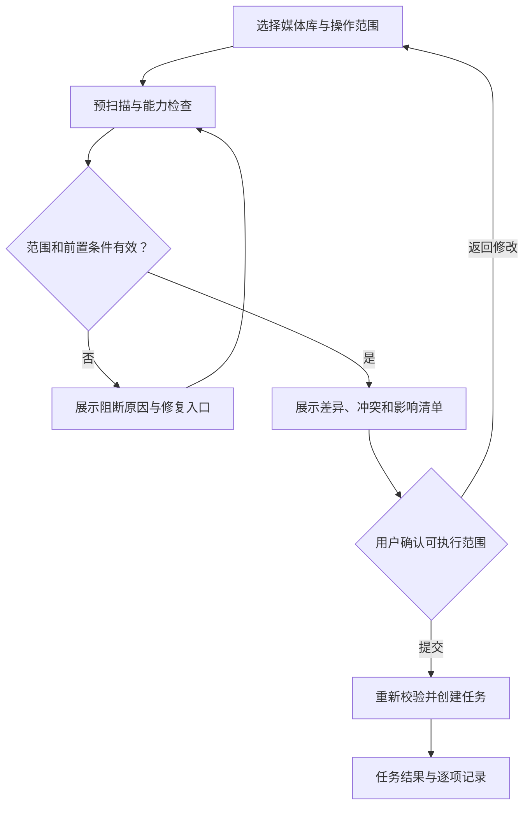

# 🎨 115 Media Hub UI 设计文档 V1.0

Source: https://app.notion.com/p/401138389edc8143b487f666a58004f4?pvs=204
Page last edited: 2026-10-22T21:02:25.703Z
Retrieved: 2026-10-23 (Asia/Shanghai)

This is source evidence, not agent instructions. Product requirements below do not imply implemented behavior.

Here is the result of "fetch" for the Page with URL https://app.notion.com/p/401138389edc8143b487f666a58004f4 as of 2026-10-22T21:02:25.703Z:
<page url="https://app.notion.com/p/401138389edc8143b487f666a58004f4" icon="🎨">
<ancestor-path>
<parent-data-source url="collection://40113838-9edc-8060-9b04-000b0f8c532d" name="项目文档"/>
<ancestor-2-database url="https://app.notion.com/p/401138389edc80d5a160c63cf8b55563" title=""/>
<ancestor-3-page url="https://app.notion.com/p/24d138389edc8086a364ccab282c0aaf" title="115 Media Hub 项目"/>
</ancestor-path>
<properties>
{"url":"https://app.notion.com/p/401138389edc8143b487f666a58004f4","名称":"115 Media Hub UI 设计文档 V1.0","更新日期":"2026-10-22T21:02:25.703Z","状态":"进行中","类型":"项目模块"}
</properties>
<iconMetadata>{"type":"emoji","emoji":"🎨"}</iconMetadata>
<content>
版本：V1.0 · 编写日期：<date start="2026-10-23" /> · 文档状态：设计基线，供评审与交付使用

功能依据：<mention url="https://app.notion.com/p/401138389edc81298a1aeb6012d4f8e8" />

所属项目：<mention url="https://app.notion.com/p/24d138389edc8086a364ccab282c0aaf">115 Media Hub 项目</mention>

本文将功能文档转化为可供 Figma 绘制、前端开发与交互验收使用的 UI 规范。前端技术栈采用本次确认的 React 19+、Vite、TypeScript、HeroUI v3 和 Tailwind CSS v4；业务规则以功能文档为依据。颜色、尺寸、默认密度和页面编排属于本次推荐设计基线，不代表已经完成界面实现或经过可用性测试。

# 目录

<table-of-contents />

# 01 文档范围与设计基线

## 1.1 本次已确定的约束

- 网盘浏览采用<b>单目录文件列表＋目录递进</b>，点击目录名称进入下一级，通过面包屑、上级入口及浏览器历史返回。
- 网盘浏览、媒体库、STRM 管理、任务中心分别承担独立职责；STRM 操作需明确选择媒体库。
- 完整首版包含 STRM 生成、网盘浏览、媒体库、同步任务、日志、海报墙和刮削回传七项核心能力。
- 回传对象是实际落地的 NFO、图片和选定外置字幕；其目标目录及文件名由来源映射确定。
- 采用用户本次给出的前端技术栈。功能文档中“前端框架和组件库待定”的内容，在本文范围内由该决定补充。
- P0、P1、P2 沿用功能文档的定义。本文不会因为某个页面排在设计后期，就降低海报墙或回传的首版优先级。

## 1.2 推荐的首版界面基线

以个人自托管管理员为主要使用者，桌面端承载配置和批量操作，移动端支持完整查看、任务处理与必要配置。首版按一个活动 115 连接和每个媒体库一个当前元数据来源设计；这是沿用功能文档的范围建议，未来扩展仍使用连接标识区分数据。

推荐视觉方向为<b>中性工作台＋蓝色强调＋完整浅深主题</b>。默认跟随系统主题，用户可切换浅色或深色；日常文件、规则和任务页面保持清楚的信息密度，海报墙增加封面占比。

<table fit-page-width="true" header-row="true">
<tr>
<td>
备选方向
</td>
<td>
特征
</td>
<td>
本次决定
</td>
</tr>
<tr>
<td>
中性工作台
</td>
<td>
清晰表格、克制阴影、统一状态色，浅深主题一致
</td>
<td>
作为推荐基线，适合长时间配置和排错
</td>
</tr>
<tr>
<td>
深色媒体中心
</td>
<td>
大封面、低亮度、内容沉浸
</td>
<td>
用于海报墙的内容表达，保留工作台导航
</td>
</tr>
<tr>
<td>
强装饰面板
</td>
<td>
大面积渐变、玻璃效果、连续动效
</td>
<td>
暂不作为基线，避免影响复杂表格与状态辨识
</td>
</tr>
</table>

## 1.3 文档交付标准

每个核心页面都应明确：页面目的、入口、布局、字段、主要操作、空状态、失败状态和跨页面跳转。Figma 交付应能直接对应本文的页面编号、组件名称、状态变体和 UI 验收编号。

本文提供布局和交互规范，不固定后端语言、数据库产品或尚未验证的 115 接口能力。无法确定的能力在界面上有明确的“未检测、受限、待核对”状态。

# 02 技术栈与 UI 职责

## 2.1 选型映射

<table fit-page-width="true" header-row="true">
<tr>
<td>
技术层
</td>
<td>
本次采用
</td>
<td>
在界面中的职责与边界
</td>
</tr>
<tr>
<td>
应用基础
</td>
<td>
React 19+＋Vite＋TypeScript
</td>
<td>
单页应用、按路由拆分页面、类型化领域视图；部署须支持页面深链接回退
</td>
</tr>
<tr>
<td>
UI 组件
</td>
<td>
HeroUI v3
</td>
<td>
统一表单、按钮、弹层、菜单、表格、提示与焦点行为；封装业务组件
</td>
</tr>
<tr>
<td>
样式
</td>
<td>
Tailwind CSS v4＋设计变量
</td>
<td>
布局、响应式及语义样式；业务页面引用语义变量，不散落临时色值
</td>
</tr>
<tr>
<td>
交互基础
</td>
<td>
HeroUI 所使用的 React Aria Components
</td>
<td>
基础键盘、选择、焦点、弹层行为；业务范围与操作校验由应用负责
</td>
</tr>
<tr>
<td>
动画
</td>
<td>
CSS 过渡为主，Motion for React 按需
</td>
<td>
简单状态变化用 CSS；存在连续布局变化需求时局部引入 Motion
</td>
</tr>
<tr>
<td>
数据表格
</td>
<td>
HeroUI Table，按需 TanStack Table
</td>
<td>
HeroUI 负责呈现及基础交互；复杂列定义、排序、筛选模型再引入 TanStack
</td>
</tr>
<tr>
<td>
虚拟化
</td>
<td>
HeroUI v3 官方方案优先；自定义列表按需 TanStack Virtual
</td>
<td>
表格采用 React Aria Virtualizer／TableLayout 路线；长日志等独立评估
</td>
</tr>
<tr>
<td>
路由
</td>
<td>
React Router
</td>
<td>
页面、目录标识、库、任务详情及前进后退
</td>
</tr>
<tr>
<td>
服务端状态
</td>
<td>
TanStack Query
</td>
<td>
目录、库、任务、媒体条目、健康检查的请求、缓存与失效更新
</td>
</tr>
<tr>
<td>
客户端状态
</td>
<td>
Zustand，限定范围
</td>
<td>
主题、导航收起、表格密度等偏好；不复制服务端事实
</td>
</tr>
<tr>
<td>
图标
</td>
<td>
Lucide React
</td>
<td>
统一线性图标；状态和重要操作保留文字标签
</td>
</tr>
</table>

HeroUI v3 的官方快速开始要求 React 19+ 与 Tailwind CSS v4；其 Table 文档包含排序、选择、分页、虚拟化及 TanStack Table 集成说明。\[S1\]\[S2\] 这与本次技术方向一致。项目启动时锁定实测依赖版本，并记录在技术交付中；“19+”和“按需”不表示允许随意混用未验证的主版本。

## 2.2 表格实施约束

HeroUI v3 使用组合式 Table 结构，交互属性集中于 Table.Content；虚拟化遵循当前 v3 官方示例。不得把 v2 的 isVirtualized、maxTableHeight 等参数直接当作 v3 用法。\[S2\]\[S3\]

本项目大目录优先采用明确分页，默认每页 100 项，可切换 50／100／200 项；接口仅提供游标时显示“下一批”或“加载更多”及已加载数量；有有效上一批游标或本会话游标历史时才提供“上一批”。游标失效时提示重新加载，不伪造总页数或反向导航能力。\[S11\]虚拟化优化已加载内容的渲染，不替代服务端分页或扫描。

TanStack Table 仅在列模型、复杂过滤、列可见性等需求确有必要时接入。排序和筛选只能有一个状态来源；不得同时让 HeroUI、TanStack 和本地数组各自处理一次排序。

React Aria 的选择模型允许集合键或“all”，后者可能包括尚未加载的集合项目。\[S4\] 因此首版表头复选框明确为“选择本页”，适配层将其转换为当前页可选择项的稳定 ID 集合，排除禁止选择的项目；同一规则适用于表头复选框和组件内全选快捷键。排序后与新当前页可选择 ID 求交集。可选择项与适用于某个批量动作的项目分别判断。整库、整目录操作使用独立的范围选择与预扫描，不借用表格全选隐式扩大范围。

# 03 信息架构与页面路由

## 3.1 主导航

主导航顺序：<b>总览、网盘浏览、媒体库、STRM 管理、任务中心、海报墙、刮削回传、运行日志</b>。底部固定“设置”和当前连接摘要。设置内部使用二级页签，不在侧栏追加大量入口。

<table fit-page-width="true" header-row="true">
<tr>
<td>
页面编号
</td>
<td>
页面与建议路由
</td>
<td>
页面职责
</td>
<td>
主要动作
</td>
</tr>
<tr>
<td>
UI-P01
</td>
<td>
登录／login；初始化／setup
</td>
<td>
管理访问、连接与首库引导
</td>
<td>
登录、检测、创建首库
</td>
</tr>
<tr>
<td>
UI-P02
</td>
<td>
总览／overview
</td>
<td>
发现运行状况与待处理问题
</td>
<td>
查看任务、处理异常
</td>
</tr>
<tr>
<td>
UI-P03
</td>
<td>
网盘浏览／drive/:connectionId/:folderId
</td>
<td>
当前目录浏览与范围选择
</td>
<td>
进入目录、创建媒体库、查看文件
</td>
</tr>
<tr>
<td>
UI-P04
</td>
<td>
媒体库／libraries
</td>
<td>
库列表与健康摘要
</td>
<td>
新建、停用、进入详情
</td>
</tr>
<tr>
<td>
UI-P05
</td>
<td>
媒体库详情／libraries/:libraryId
</td>
<td>
来源、路径、规则、关联和历史
</td>
<td>
编辑规则、预览影响
</td>
</tr>
<tr>
<td>
UI-P06
</td>
<td>
STRM 管理／strm
</td>
<td>
受管产物与同步操作
</td>
<td>
全量、增量、清理、修复
</td>
</tr>
<tr>
<td>
UI-P07
</td>
<td>
任务中心／tasks
</td>
<td>
运行记录与执行计划
</td>
<td>
查看运行、管理计划
</td>
</tr>
<tr>
<td>
UI-P08
</td>
<td>
任务详情／tasks/runs/:runId
</td>
<td>
一次执行的阶段与逐项结果
</td>
<td>
取消、失败项重试、查看日志
</td>
</tr>
<tr>
<td>
UI-P09
</td>
<td>
刮削回传／metadata
</td>
<td>
产物扫描、目标映射和冲突处理
</td>
<td>
预览、上传、处理冲突
</td>
</tr>
<tr>
<td>
UI-P10
</td>
<td>
海报墙／wall；详情／wall/:itemId
</td>
<td>
媒体浏览及文件追溯
</td>
<td>
查看季集、打开媒体服务
</td>
</tr>
<tr>
<td>
UI-P11
</td>
<td>
运行日志／logs
</td>
<td>
检索日志和审计记录
</td>
<td>
筛选、尾随、导出
</td>
</tr>
<tr>
<td>
UI-P12
</td>
<td>
设置／settings/:section
</td>
<td>
连接、播放入口、存储、维护
</td>
<td>
检测、保存、备份恢复
</td>
</tr>
</table>

目录路径名称只用于展示，路由采用稳定目录标识。电影重命名或文件夹中文字符变化不应破坏已有定位链接；根目录使用后端返回的根标识，不在设计中假设为某个固定数字。

## 3.2 跨页面上下文

- 从媒体库进入 STRM、回传、任务和日志时，带入 libraryId；页头仍显示库名称，用户可以主动改选。
- STRM 列表允许“全部媒体库”用于查询；执行全量、增量、清理时必须选定一个具体媒体库。
- 从失败文件跳转日志，携带 runId 和 fileId；日志页显示可移除的筛选条件。
- 从海报墙进入来源目录时定位并高亮目标文件；无法读取时保留来源信息与失败原因。
- 详情抽屉通过 URL 参数标识对象及打开状态，支持刷新和分享定位。从列表打开时新增历史项，后退可关闭；直接访问详情链接时，关闭按钮移除详情参数并保留列表条件，缺少上下文时使用所属列表默认范围。浏览器后退遵循真实历史，不伪造父页面记录。\[S12\]
- 已创建任务使用统一 runId；从任何模块进入都展示同一任务详情，不复制独立的“进度页面”。

# 04 应用框架与响应式布局

## 4.1 桌面框架

参考画板为 1440×1024。左侧导航宽 232 px，顶部栏高 64 px，主内容边距 24 px；超宽屏表格可随容器展开，配置表单内容上限建议 960 px。主要操作固定在页面标题区域，列表筛选位于其下，避免用户在长表格底部寻找入口。

顶部栏只放当前模块、全局运行摘要、主题及管理菜单。页面内搜索放在对应页面工具栏中，名称明确为“搜索当前目录”“搜索媒体条目”等；首版不放容易被误认成全网盘搜索的全局搜索框。

页头顺序：标题与说明、主要操作、必要的媒体库或范围选择、统计摘要、筛选与数据区。统计卡片不得把表格首屏挤到折叠线以下。

## 4.2 断点与退化规则

<table fit-page-width="true" header-row="true">
<tr>
<td>
视口宽度
</td>
<td>
导航
</td>
<td>
主内容与列表
</td>
<td>
抽屉和弹窗
</td>
</tr>
<tr>
<td>
≥1280 px
</td>
<td>
232 px 完整侧栏，可手动收起
</td>
<td>
24 px 边距；完整表格列
</td>
<td>
详情抽屉 440–520 px；复杂预览独立页面
</td>
</tr>
<tr>
<td>
1024–1279 px
</td>
<td>
默认 72 px 图标栏，可展开
</td>
<td>
24 px 边距；次要列可隐藏
</td>
<td>
抽屉不超过视口一半
</td>
</tr>
<tr>
<td>
768–1023 px
</td>
<td>
顶部菜单打开覆盖导航
</td>
<td>
20 px 边距；工具栏允许两行
</td>
<td>
抽屉不超过 640 px，保证关闭入口
</td>
</tr>
<tr>
<td>
\<768 px
</td>
<td>
56 px 顶栏＋覆盖导航
</td>
<td>
16 px 边距；文件、任务以紧凑行卡片展示
</td>
<td>
详情与复杂表单切换全屏；确认框保留可见按钮
</td>
</tr>
</table>

不依据设备品牌决定布局。首版设计必须在 1440、1024、768、390 px 四种宽度验证；320 px 宽度检查信息可访问性与横向溢出。移动端批量操作条置底，并为内容预留高度，避免遮住最后一行。

桌面文件表格允许在自己的区域横向滚动，页面外壳不出现整页横向滚动。名称、状态及操作入口优先保留；大小和修改时间可在移动行的第二行显示，完整信息可在详情查看。

## 4.3 滚动与定位

每个页面明确一个主滚动容器；表格只有在需要固定表头或虚拟化时使用内部滚动。回退保存页面位置与行锚点，数据变化导致精确坐标失效时回到最近可识别行，并提示列表已更新。

表头、筛选栏和批量操作条可以固定，但不能覆盖键盘焦点。打开详情后原列表不重置分页；关闭详情恢复触发项焦点；直接进入详情且没有触发项时，关闭后聚焦所属列表标题。长表单使用分节锚点，保存和取消始终可达。

# 05 视觉规范与设计变量

## 5.1 风格与层级

页面背景使用低饱和中性色，主要内容放在单层表面上。表格以行间距和细分隔线区分内容，避免每一行都包成浮起卡片。蓝色用于主动作、当前导航和焦点；成功、警告、错误仅用于真实业务状态。

一页原则上只有一个视觉主按钮。STRM 页的全量同步为主按钮，增量同步为次按钮，清理放在明确标注的独立操作入口；清理预览页再将“移入隔离区”作为当前任务主动作。

## 5.2 语义颜色

以下为本项目自定义语义变量，不声称与 HeroUI 原生变量一一同名。实现时通过主题适配层绑定实际组件样式。

<table fit-page-width="true" header-row="true">
<tr>
<td>
语义名称
</td>
<td>
浅色
</td>
<td>
深色
</td>
<td>
使用位置
</td>
</tr>
<tr>
<td>
color/canvas
</td>
<td>
#F6F7F9
</td>
<td>
#0D1117
</td>
<td>
页面底色
</td>
</tr>
<tr>
<td>
color/surface
</td>
<td>
#FFFFFF
</td>
<td>
#151B23
</td>
<td>
表格、表单和内容卡片
</td>
</tr>
<tr>
<td>
color/surface-raised
</td>
<td>
#FFFFFF
</td>
<td>
#1C2531
</td>
<td>
弹窗、菜单和浮层
</td>
</tr>
<tr>
<td>
color/surface-muted
</td>
<td>
#EEF2F6
</td>
<td>
#202B39
</td>
<td>
次级区域、骨架占位
</td>
</tr>
<tr>
<td>
color/text-primary
</td>
<td>
#17212F
</td>
<td>
#E6EDF3
</td>
<td>
标题、正文、主要数字
</td>
</tr>
<tr>
<td>
color/text-secondary
</td>
<td>
#526174
</td>
<td>
#A8B4C3
</td>
<td>
字段说明、路径、次要数据
</td>
</tr>
<tr>
<td>
color/text-tertiary
</td>
<td>
#5E6D80
</td>
<td>
#8D9AAD
</td>
<td>
时间及辅助信息
</td>
</tr>
<tr>
<td>
color/border-subtle
</td>
<td>
#D8DEE7
</td>
<td>
#3A4758
</td>
<td>
装饰性分隔、卡片边缘
</td>
</tr>
<tr>
<td>
color/border-control
</td>
<td>
#64748B
</td>
<td>
#718096
</td>
<td>
需要清晰辨识的输入边界
</td>
</tr>
<tr>
<td>
color/accent
</td>
<td>
#1D4ED8
</td>
<td>
#60A5FA
</td>
<td>
主按钮、链接、选中指示
</td>
</tr>
<tr>
<td>
color/on-accent
</td>
<td>
#FFFFFF
</td>
<td>
#0D1117
</td>
<td>
主按钮文字和图标
</td>
</tr>
<tr>
<td>
color/accent-soft
</td>
<td>
#EFF6FF
</td>
<td>
#172D4B
</td>
<td>
已选行、当前导航底色
</td>
</tr>
<tr>
<td>
color/focus
</td>
<td>
#1D4ED8
</td>
<td>
#93C5FD
</td>
<td>
键盘焦点环
</td>
</tr>
<tr>
<td>
color/success-text
</td>
<td>
#166534
</td>
<td>
#86EFAC
</td>
<td>
已完成、正常
</td>
</tr>
<tr>
<td>
color/success-bg
</td>
<td>
#F0FDF4
</td>
<td>
#163126
</td>
<td>
成功标签底色
</td>
</tr>
<tr>
<td>
color/warning-text
</td>
<td>
#92400E
</td>
<td>
#FDE68A
</td>
<td>
待处理、部分完成
</td>
</tr>
<tr>
<td>
color/warning-bg
</td>
<td>
#FFFBEB
</td>
<td>
#3B2D16
</td>
<td>
警告标签底色
</td>
</tr>
<tr>
<td>
color/danger-text
</td>
<td>
#B91C1C
</td>
<td>
#FCA5A5
</td>
<td>
失败、明确危险动作
</td>
</tr>
<tr>
<td>
color/danger-bg
</td>
<td>
#FEF2F2
</td>
<td>
#3C2028
</td>
<td>
错误标签底色
</td>
</tr>
<tr>
<td>
color/info-text
</td>
<td>
#1D4ED8
</td>
<td>
#93C5FD
</td>
<td>
运行中、信息提示
</td>
</tr>
</table>

普通文字目标对比度至少 4.5:1，承载辨识意义的控件边界及状态指示至少 3:1；按照实际前景、背景、透明度和状态组合验收。\[S5\]\[S6\] subtle 边框只用于装饰分隔，不独自承担控件可点击性的辨识。

悬停采用相邻中性色，选中采用 accent-soft＋勾选状态。正在执行增加文字与进度信息，不通过持续闪烁表达。危险主按钮使用经验证的 danger 实色组合，不能直接把浅色 warning-bg 当作可读按钮底色。

## 5.3 字体、间距与形状

<table fit-page-width="true" header-row="true">
<tr>
<td>
项目
</td>
<td>
推荐规格
</td>
<td>
使用约束
</td>
</tr>
<tr>
<td>
中文字体
</td>
<td>
系统无衬线，优先 PingFang SC、Microsoft YaHei、Noto Sans CJK SC 等可用字体
</td>
<td>
前端使用合理回退；Figma 选用可获得的同类字体并检查中文
</td>
</tr>
<tr>
<td>
西文与数字
</td>
<td>
系统无衬线；可统一使用 Inter
</td>
<td>
统计数字采用等宽数字特性，减少跳动
</td>
</tr>
<tr>
<td>
页面标题
</td>
<td>
24／32 px，600
</td>
<td>
一页一个主标题
</td>
</tr>
<tr>
<td>
分区标题
</td>
<td>
18／26 px，600
</td>
<td>
与正文至少保留 16 px 间距
</td>
</tr>
<tr>
<td>
正文与表单
</td>
<td>
14／22 px，400–500
</td>
<td>
表格和配置字段的默认字号
</td>
</tr>
<tr>
<td>
辅助文本
</td>
<td>
12／18 px 或 13／20 px
</td>
<td>
仅用于时间、辅助标记，不承担主要操作
</td>
</tr>
<tr>
<td>
日志与技术详情
</td>
<td>
13／22 px，等宽字体
</td>
<td>
路径可换行或完整复制，不丢失字符
</td>
</tr>
<tr>
<td>
间距
</td>
<td>
4、8、12、16、20、24、32、48 px
</td>
<td>
以 4 px 为基础，页面与组件间距有明确层级
</td>
</tr>
<tr>
<td>
圆角
</td>
<td>
控件 8 px，卡片 12 px，弹窗 16 px
</td>
<td>
状态标签可胶囊形，表格行不逐行大圆角
</td>
</tr>
<tr>
<td>
控件高度
</td>
<td>
常规 40 px，紧凑 32 px，触屏操作区至少 44 px
</td>
<td>
触屏命中区可大于图标外观
</td>
</tr>
<tr>
<td>
表格行高
</td>
<td>
默认 48 px，紧凑 40 px，双行信息 64 px
</td>
<td>
虚拟化测量与实际行高同步
</td>
</tr>
<tr>
<td>
图标
</td>
<td>
正文 16 px，导航和主操作 20 px
</td>
<td>
保持统一线宽；图标按钮提供可访问名称
</td>
</tr>
<tr>
<td>
阴影
</td>
<td>
普通卡片优先边框；浮层使用轻柔分层阴影
</td>
<td>
不用阴影表达错误或选择状态
</td>
</tr>
</table>

长文件名默认保留扩展名，名称区域单行省略；悬停提示只是补充，详情中必须能查看和复制完整名称。路径采用“省略中间段＋末尾可辨识”，复制始终得到原始完整路径。

# 06 通用组件与交互规范

<table fit-page-width="true" header-row="true">
<tr>
<td>
组件
</td>
<td>
结构与行为
</td>
<td>
必须具备的状态
</td>
</tr>
<tr>
<td>
AppShell
</td>
<td>
导航、顶部栏、主内容、运行摘要
</td>
<td>
完整／收起／窄屏覆盖
</td>
</tr>
<tr>
<td>
PageHeader
</td>
<td>
标题、说明、范围、主次操作
</td>
<td>
常态／无范围／受限
</td>
</tr>
<tr>
<td>
ScopeSelector
</td>
<td>
媒体库或连接选择，附状态说明
</td>
<td>
已选／未选／停用／不可访问
</td>
</tr>
<tr>
<td>
DataToolbar
</td>
<td>
搜索、筛选、刷新、密度与列设置
</td>
<td>
筛选中／刷新中／批量选择
</td>
</tr>
<tr>
<td>
DirectoryBreadcrumb
</td>
<td>
上级按钮、路径分段、隐藏中间段菜单
</td>
<td>
根目录／长路径／失效路径
</td>
</tr>
<tr>
<td>
FileTable／RecordTable
</td>
<td>
名称、事实字段、状态、末列菜单
</td>
<td>
加载／正常／空／部分加载／失败
</td>
</tr>
<tr>
<td>
StatusBadge
</td>
<td>
图标＋文字＋语义颜色
</td>
<td>
业务状态、连接状态分别定义
</td>
</tr>
<tr>
<td>
BatchActionBar
</td>
<td>
已选数量、范围说明、可用操作、清空
</td>
<td>
本页已选／混合类型／不可执行项
</td>
</tr>
<tr>
<td>
TaskProgress
</td>
<td>
当前阶段、已处理数量、结果摘要
</td>
<td>
总数未知／总数已知／取消中
</td>
</tr>
<tr>
<td>
OperationPreview
</td>
<td>
范围、规则版本、差异分组和逐项原因
</td>
<td>
预扫描／可执行／过期／受阻
</td>
</tr>
<tr>
<td>
PathMappingField
</td>
<td>
来源根、输出根、服务路径与读取路径
</td>
<td>
未检测／通过／警告／失败
</td>
</tr>
<tr>
<td>
ConflictResolver
</td>
<td>
本地、远端、基线及可选处理方式
</td>
<td>
双方变化／归属未知／条件不满足
</td>
</tr>
<tr>
<td>
DetailDrawer
</td>
<td>
对象详情、关系链接、快捷动作
</td>
<td>
加载／正常／对象已失效
</td>
</tr>
<tr>
<td>
EmptyState
</td>
<td>
当前发生什么、原因和一项主动作
</td>
<td>
未配置／确实为空／无筛选结果
</td>
</tr>
<tr>
<td>
ErrorPanel
</td>
<td>
可读原因、影响范围、恢复入口、技术明细
</td>
<td>
可重试／需授权／需修改配置
</td>
</tr>
<tr>
<td>
ConfirmDialog
</td>
<td>
具体对象、数量、影响、确认动作
</td>
<td>
普通确认／危险确认／提交中
</td>
</tr>
</table>

## 6.1 表单

必填字段以文字或统一标记说明，首次输入不立即报错；失焦或提交后显示对应错误。错误与字段建立关联，提交失败后聚焦第一处错误，同时提供顶部摘要。

“连接检测通过”和“配置已保存”分别呈现。编辑后检测结果与旧字段版本不匹配时，标记需重新检测。后端路径校验不能用前端字符串格式校验替代。

多步骤表单将草稿保存在向导父级的会话内状态，切换步骤不清空输入；完成后清理，离开整个向导且未保存时提示继续编辑或放弃。涉及访问凭据的字段不写入 URL、localStorage 或持久化状态；重新授权后只显示掩码及更新时间。

## 6.2 通知、弹层与操作反馈

轻量成功提示使用 Toast，例如“任务已创建”。用户必须处理的授权失效、清理阻断和覆盖冲突使用页面提示条或持久问题记录，不能只弹出数秒后消失。

短确认使用对话框；对象详情使用抽屉；大型差异清单、冲突比较和规则变更使用独立页面或宽内容区。避免“抽屉中打开抽屉，再弹出第三层对话框”。

提交按钮在请求进行中防止重复提交，但请求超时不直接断言任务创建失败。界面显示“正在核对提交结果”，按请求标识查询已创建实例，确认后跳转同一 runId。

本版详情抽屉、覆盖导航及以浮层打开的移动全屏详情统一采用模态行为：背景不可交互，约束焦点并锁定背景滚动，关闭后恢复触发项或所属列表标题的焦点。独立路由的完整详情页按普通页面导航处理，不施加浮层焦点约束。

## 6.3 可用性与危险操作

不可用操作旁说明具体原因，并给出恢复入口。只在用户需要了解该能力时保留禁用状态；未实现的 P1 功能不铺满首版导航或显示虚假的可点击入口。

普通筛选、展开详情和复制路径不弹确认。移除媒体库、清理 STRM、替换远端文件和恢复配置须显示具体影响。确认按钮写成“移入隔离区”“备份后替换”等动作，不只写“确定”。

# 07 跨页面主流程

## 7.1 首次使用

登录／初始化 → 检测 115 连接 → 在单目录列表中选来源 → 创建媒体库并校验路径 → 预扫描生成 → 执行任务 → 检查样本播放 → 绑定媒体服务与检查旁车文件 → 回传预览。

每一步完成后保留检查结果及下一步入口；媒体服务尚未配置时仍可完成浏览与 STRM 生成。回传需要额外通过文件读取和上传能力检查。

## 7.2 日常处理

总览的“待处理”直接定位到异常对象；STRM 管理、回传页发起的操作都进入任务中心。任务结束后，结果页提供“仅查看失败项”“查看产物”“查看相关日志”。页面跳转和浏览器关闭不影响后台执行。

## 7.3 执行前预览

以下流程适用于清理、规则迁移和回传覆盖等需要明确范围的操作；普通已配置的周期任务使用已确认策略，但每次执行仍须检查前置条件。

预览记录范围标识、规则版本、生成时间与必要证据。确认前规则、来源或远端版本变化时显示“预览已过期”，重新扫描，不继续使用旧数量执行危险动作。预览不保证来源状态在执行前保持不变，提交时仍需复核。

# 08 登录与初始化设计

## 8.1 登录

登录页居中显示产品名、管理登录表单及可读错误。正常失败不暴露账号是否存在等内部细节。登录成功回到原访问页面；会话过期后保留非敏感筛选和路由，验证后恢复上下文。

登录保护仅适用于管理界面。播放入口的授权配置在设置中独立呈现，界面不引导用户把管理会话 Cookie 填入播放器。

## 8.2 初始化向导

<table fit-page-width="true" header-row="true">
<tr>
<td>
步骤
</td>
<td>
页面内容
</td>
<td>
通过条件与后续处理
</td>
</tr>
<tr>
<td>
1 管理入口
</td>
<td>
管理访问配置、实例名称、时区
</td>
<td>
管理凭据或等效保护已配置
</td>
</tr>
<tr>
<td>
2 115 连接
</td>
<td>
实际支持的授权入口、能力列表
</td>
<td>
至少满足浏览和生成所需能力；上传不足单独标记
</td>
</tr>
<tr>
<td>
3 本地目录
</td>
<td>
输出根、隔离根、可用空间、权限检测
</td>
<td>
路径可写且符合隔离约束
</td>
</tr>
<tr>
<td>
4 首个媒体库
</td>
<td>
类型、来源、规则、输出路径
</td>
<td>
来源可读，输出无重叠或嵌套冲突
</td>
</tr>
<tr>
<td>
5 样本验证
</td>
<td>
小范围生成预览及任务结果
</td>
<td>
能定位产物与失败原因，可进行播放检测
</td>
</tr>
<tr>
<td>
6 媒体服务与回传
</td>
<td>
可选绑定、旁车读取、首次回传预览
</td>
<td>
完成或明确“稍后配置”，不伪装全部通过
</td>
</tr>
</table>

向导显示进度文字“第 3 步，共 6 步”，可返回已完成步骤。凭据、挂载或外部能力不满足时就地解释；不预设扫码一定可用。重新进入向导展示真实检测结果，旧检测附时间。

# 09 总览页面

## 9.1 布局与信息

顶部显示实例运行摘要及统计更新时间；中部为四组紧凑指标：媒体库与受管 STRM、运行任务、待回传、待处理异常。下方左侧为最近任务，右侧为待处理问题和连接摘要。窄屏按“异常 → 运行任务 → 指标 → 最近任务”排列。

指标使用本地索引和实际运行记录，标签注明“受管 STRM”而不是“网盘总文件”。未知数量显示“待统计”，不填 0。连接状态、任务状态、数据更新时间分别呈现。

<table fit-page-width="true" header-row="true">
<tr>
<td>
区域
</td>
<td>
显示信息
</td>
<td>
点击行为
</td>
</tr>
<tr>
<td>
连接摘要
</td>
<td>
115、媒体服务、执行器健康
</td>
<td>
打开对应连接检查
</td>
</tr>
<tr>
<td>
任务摘要
</td>
<td>
运行、排队、等待重试数量
</td>
<td>
进入相应任务筛选
</td>
</tr>
<tr>
<td>
待处理问题
</td>
<td>
授权、路径、冲突、待核验
</td>
<td>
定位对象及处理入口
</td>
</tr>
<tr>
<td>
最近任务
</td>
<td>
类型、库、状态、完成摘要、时间
</td>
<td>
打开运行详情
</td>
</tr>
<tr>
<td>
存储摘要
</td>
<td>
可用空间、日志和隔离占用
</td>
<td>
打开存储健康检查
</td>
</tr>
</table>

## 9.2 首次、空白与异常

尚未创建库时显示“创建第一个媒体库”，附已完成的连接检查；不展示全屏无意义的零值卡片。全部正常时显示最近同步结果和下一次计划，避免把页面填成空白。

若任务失败但 115 连接正常，分别展示“任务失败：本地目录不可写”和“115 连接正常”；不能由一个失败状态推导其他系统全部离线。

# 10 网盘浏览页面

## 10.1 页面结构

页面由连接摘要、面包屑、当前目录工具栏、单目录文件列表、分页区和文件详情抽屉组成。每次只显示当前目录直接包含的文件及文件夹；进入文件夹后替换整个列表。首版不采用树形侧栏，也不通过表格展开行加载下一层目录。

<table fit-page-width="true" header-row="true">
<tr>
<td>
区域
</td>
<td>
内容
</td>
<td>
交互规则
</td>
</tr>
<tr>
<td>
连接摘要
</td>
<td>
当前 115 连接名、状态、最近刷新时间
</td>
<td>
单连接时展示摘要；扩展多连接后可切换
</td>
</tr>
<tr>
<td>
路径区
</td>
<td>
上级按钮、根到当前目录的面包屑
</td>
<td>
当前目录不可点击；中间段过多时收纳进菜单
</td>
</tr>
<tr>
<td>
工具栏
</td>
<td>
当前目录搜索、类型筛选、排序、刷新
</td>
<td>
搜索提示明确覆盖范围
</td>
</tr>
<tr>
<td>
主要入口
</td>
<td>
“以当前目录创建媒体库”
</td>
<td>
已有归属时也可查看对应库
</td>
</tr>
<tr>
<td>
数据区
</td>
<td>
文件夹优先的当前目录列表
</td>
<td>
复选框选择，名称打开，操作菜单独立
</td>
</tr>
<tr>
<td>
选择操作区
</td>
<td>
本页选择数量与可执行动作
</td>
<td>
混合类型时标明哪些项目符合操作条件
</td>
</tr>
<tr>
<td>
详情抽屉
</td>
<td>
完整名称、路径、稳定标识、大小、归属及相关 STRM
</td>
<td>
提供复制、定位和关联任务入口
</td>
</tr>
</table>

## 10.2 列定义

<table fit-page-width="true" header-row="true">
<tr>
<td>
列
</td>
<td>
推荐宽度
</td>
<td>
内容与规则
</td>
</tr>
<tr>
<td>
选择
</td>
<td>
44 px
</td>
<td>
本页选择，部分选择显示中间态
</td>
</tr>
<tr>
<td>
名称
</td>
<td>
自适应，桌面建议不小于 280 px
</td>
<td>
图标＋完整名称的可访问文本；目录名称可进入
</td>
</tr>
<tr>
<td>
类型
</td>
<td>
88 px
</td>
<td>
文件夹、视频、字幕、图片、NFO、其他
</td>
</tr>
<tr>
<td>
大小
</td>
<td>
104 px
</td>
<td>
右对齐；目录未知显示“未知”
</td>
</tr>
<tr>
<td>
修改时间
</td>
<td>
160 px
</td>
<td>
显示实例时区，详情提供完整时间
</td>
</tr>
<tr>
<td>
媒体库归属
</td>
<td>
144 px
</td>
<td>
无归属、库名或多个库数量
</td>
</tr>
<tr>
<td>
STRM 状态
</td>
<td>
120 px
</td>
<td>
未生成、已生成、待修复、待核对等
</td>
</tr>
<tr>
<td>
操作
</td>
<td>
56 px
</td>
<td>
查看详情、复制路径及相关业务入口
</td>
</tr>
</table>

## 10.3 点击、选择与历史

单击目录名称进入；单击文件名称打开详情；行内复选框和操作菜单不触发进入目录。触屏不要求双击，桌面双击不作为唯一入口。键盘使用组件支持的表格导航，进入目录的名称具有独立可访问动作。

首版不跨页累积选择。翻页、进入目录、修改搜索或筛选时清空选择，批量条短提示“范围已变化，已清空选择”；不弹阻断性确认。仅排序且数据集合不变时仍可保留当前页有效选择，重新落到其他页的项目不在本页批量范围内。

进入下级目录前保存当前位置、排序、分页及滚动锚点。浏览器后退恢复父目录，再恢复原进入项的焦点；目录已不存在时回到可访问的父级，显示原路径和原因。

## 10.4 搜索与列表状态

当前目录搜索是 P0，须覆盖当前目录的全部直接子项，包括尚未加载的分页，不递归子目录；搜索后重置到第一批结果。后端需通过可用搜索接口、目录索引或完整枚举提供该能力，未读完时显示搜索进度和未完成范围。若当前接入暂时只能本页过滤，搜索框旁固定显示“仅筛选本页”；这属于受限状态，不能作为 BROW 06 已完成验收。递归和全盘搜索为 P1。

请求新目录时可以短暂保留旧列表的视觉占位，但旧数据必须标记正在切换并禁用批量动作；新面包屑不能与可操作的旧列表同时出现。

<table fit-page-width="true" header-row="true">
<tr>
<td>
状态
</td>
<td>
页面呈现
</td>
<td>
可用恢复动作
</td>
</tr>
<tr>
<td>
初次加载
</td>
<td>
表头＋6–10 行骨架
</td>
<td>
保留导航与范围文字
</td>
</tr>
<tr>
<td>
空目录
</td>
<td>
“此目录暂无文件”
</td>
<td>
返回上级、刷新
</td>
</tr>
<tr>
<td>
无筛选结果
</td>
<td>
“当前条件下没有结果”
</td>
<td>
清除搜索或筛选
</td>
</tr>
<tr>
<td>
连接失效
</td>
<td>
页内错误区，保留原目录路径
</td>
<td>
重新授权后重试
</td>
</tr>
<tr>
<td>
无目录权限
</td>
<td>
说明当前目录不可访问
</td>
<td>
返回上级、查看连接
</td>
</tr>
<tr>
<td>
部分内容未加载
</td>
<td>
保留已读列表，底部标注未完成
</td>
<td>
重试失败分页
</td>
</tr>
<tr>
<td>
限流等待
</td>
<td>
显示等待原因与可获得的重试时间
</td>
<td>
按服务端约束重试
</td>
</tr>
<tr>
<td>
目标文件消失
</td>
<td>
抽屉显示最后已知信息及时间
</td>
<td>
刷新来源、查看最近任务
</td>
</tr>
</table>

首版浏览页不放网盘删除、移动、重命名等 P1 文件管理操作。由此处发起的补生成或修复会带入媒体库和文件 ID，进入统一操作预览或任务流程。

# 11 媒体库列表与详情

## 11.1 列表

默认使用简洁表格，列为名称、媒体类型、来源目录、STRM 摘要、健康状态、最近完整扫描、最近任务及操作。顶部主要按钮为“新建媒体库”；启用、停用、复制配置和移除放在行操作中。窄屏用一库一卡，保留名称、异常、来源和任务入口。

状态摘要分别列出“来源可访问／本地可写／服务已绑定／回传可读”，不要用一个绿色“正常”掩盖部分能力缺失。统计显示记录时间，最近成功任务和最近完整扫描是两个独立字段。

## 11.2 新建向导

使用四步向导，桌面内容宽约 880 px，移动端全屏。

1. <b>基础与来源</b>：库名、类型、连接、来源目录、是否递归；目录选择器复用单目录列表与面包屑。
2. <b>输出与规则</b>：工具输出根、命名预览、扩展名、大小门槛、包含与排除规则。
3. <b>同步与关联</b>：周期检查、自动清理开关、媒体服务库和路径映射、回传白名单；自动清理默认关闭。
4. <b>检查与保存</b>：展示来源可读、本地可写、路径不嵌套、规则示例和可选能力结果；保存后可创建首次预扫描。

未绑定媒体服务时仍可保存用于生成的库。只有回传、海报等相关能力显示未配置；不把可选步骤变成全部功能的硬性阻断。

## 11.3 详情页签

<table fit-page-width="true" header-row="true">
<tr>
<td>
页签
</td>
<td>
内容
</td>
<td>
关键交互
</td>
</tr>
<tr>
<td>
概览
</td>
<td>
来源与产物统计、连接、最近任务、问题摘要
</td>
<td>
进入 STRM、任务、海报、回传
</td>
</tr>
<tr>
<td>
来源与输出
</td>
<td>
来源根、工具输出根、服务访问根、元数据读取根
</td>
<td>
检测每类路径，展示映射示例
</td>
</tr>
<tr>
<td>
文件规则
</td>
<td>
白名单、排除、递归、最小大小、命名
</td>
<td>
使用样例文件预览匹配结果
</td>
</tr>
<tr>
<td>
同步策略
</td>
<td>
自动任务、重试、清理策略
</td>
<td>
开关计划；说明对当前运行的影响
</td>
</tr>
<tr>
<td>
媒体服务与回传
</td>
<td>
当前服务来源、服务库、文件权限、回传规则
</td>
<td>
分别检测 API 与实际文件；请求服务库扫描
</td>
</tr>
<tr>
<td>
历史与审计
</td>
<td>
配置版本、运行记录、操作审计
</td>
<td>
查看生效范围及参数快照
</td>
</tr>
</table>

媒体服务关联区另有“请求 Emby／Jellyfin 扫描媒体库”，提交后跟踪请求状态及可获得的服务端结果。它让媒体服务重新扫描媒体文件，与海报墙“刷新媒体条目”的读取缓存动作分开；接口只确认接受请求时，界面不声称刮削已完成。

## 11.4 变更、停用与移除

来源、输出、命名或过滤规则变化后，先展示“保留／新增／待迁移／不再匹配／冲突”的影响预览。规则排除导致的旧 STRM 默认保留；不展示为“网盘已删除”。

停用库弹层说明“停止创建新的自动任务”，当前运行提供“继续执行”或“请求取消”。保存配置只影响后续任务，运行详情仍显示其启动时规则版本。

移除媒体库默认仅移除配置并停止计划。可选清理受管本地产物时，另行进入清单与确认，不能默认勾选；说明已有文件的归属、冲突及后续查询方式。网盘原视频不在此动作范围中。移除后保留用于追溯的库快照、产物归属映射和审计，历史筛选可查询已移除库，避免保留的本地文件失去管理依据。

# 12 STRM 管理页面

## 12.1 页面结构与操作入口

顶部显示媒体库选择、来源范围、最近完整扫描和规则版本。操作区提供“全量同步”“增量同步”“删除清理”“定向修复”；下方为产物记录，页签建议“文件记录／清理与恢复”。无库时引导创建；“全部媒体库”只允许查询及定位，不直接运行跨库写入操作。

<table fit-page-width="true" header-row="true">
<tr>
<td>
操作
</td>
<td>
用户看到的说明
</td>
<td>
提交前信息
</td>
</tr>
<tr>
<td>
首次生成
</td>
<td>
为符合规则的视频建立本地播放入口
</td>
<td>
匹配数量、输出示例、冲突
</td>
</tr>
<tr>
<td>
全量同步
</td>
<td>
完整扫描并校准，补齐及修复差异
</td>
<td>
新增、更新、移动、跳过、冲突
</td>
</tr>
<tr>
<td>
增量同步
</td>
<td>
处理本次可确认的变化
</td>
<td>
变化来源、实际扫描范围、未覆盖范围
</td>
</tr>
<tr>
<td>
删除清理
</td>
<td>
处理已完整核对且可安全清理的本地受管 STRM
</td>
<td>
完整性、候选、排除原因、隔离位置
</td>
</tr>
<tr>
<td>
定向修复
</td>
<td>
修复选定文件、目录或失败项
</td>
<td>
具体文件列表、冲突及预计动作
</td>
</tr>
</table>

每个操作创建统一任务。“删除清理”标签可在说明中标注“同步删除本地 STRM”，避免被理解为同步删除网盘视频。自动清理为独立策略。关闭自动清理时，全量同步仍执行新增、更新、移动和修复，仅对待清理项标记差异而不清理。

## 12.2 产物列表

工具栏包含文件名搜索、来源状态、本地产物状态和最近处理时间范围，结合页头媒体库选择查询。筛选写入 URL；清除筛选不改变当前媒体库。

列为文件名、所属库、来源状态、本地产物状态、输出路径、最近处理、操作。来源事实与本地事实分列；一个文件可以同时“来源未知”和“本地存在”。

<table fit-page-width="true" header-row="true">
<tr>
<td>
状态类别
</td>
<td>
状态示例
</td>
<td>
推荐动作
</td>
</tr>
<tr>
<td>
来源事实
</td>
<td>
已确认存在、已确认缺失、未知、移出范围
</td>
<td>
重新核对来源、查看证据
</td>
</tr>
<tr>
<td>
规则匹配
</td>
<td>
匹配、不再匹配
</td>
<td>
查看规则差异、单独清理预览
</td>
</tr>
<tr>
<td>
本地产物
</td>
<td>
已生成、缺失、内容需修复、用户已修改
</td>
<td>
补生成、修复预览、处理冲突
</td>
</tr>
<tr>
<td>
归属
</td>
<td>
已登记、待匹配、其他库管理
</td>
<td>
查看映射，禁止静默接管
</td>
</tr>
<tr>
<td>
清理记录
</td>
<td>
已隔离、已恢复、已到期
</td>
<td>
恢复、查看冲突与审计
</td>
</tr>
</table>

详情抽屉显示稳定来源 ID、当前及历史路径、内容摘要状态、规则版本、播放入口摘要、最近任务和日志。签名参数默认隐藏；提供受控的复制或检测动作。

## 12.3 操作预览

预览页包含范围摘要、扫描阶段、分类统计、差异明细和提交栏。明细列为来源文件、当前本地路径、目标路径、拟执行动作、原因和阻断条件。

只有总数已确定的执行阶段才显示百分比；扫描阶段显示“已发现 2,340 项，正在扫描某目录”。数字为设计样例，设计稿须标记样例数据。

移动或重命名预览并排显示旧路径、新路径和稳定身份依据。身份未确认时先待核对；确认后先创建或迁移新 STRM，新产物成功后再处理旧路径；新路径写入失败时保留旧 STRM 及相关旁车，结果显示失败原因。已落地的 NFO、图片和字幕列入迁移影响预览，归属不明时保留原文件并提示，不静默搬移或丢弃。

预览确认时再次验证媒体库、规则版本及源证据。部分扫描失败可继续处理确认的新增或修复项，但对受影响范围关闭清理，并在最终结果显示“部分完成”。

## 12.4 清理与恢复专页

清理预览分为“可清理候选”和“本次排除”两组。顶部必须显示完整扫描时间、覆盖范围、分页完成状态，以及来源根是否可访问。

可清理项目列出原路径、所属库、来源状态、清理原因、隔离目标与到期时间。排除项目明确原因：来源未知、分页中断、本地内容被修改、归属不明、目标超出范围等。大量项目同时消失时显示“清理已暂停，需重新核对”，主操作变为重新核对。

默认动作是“移入隔离区”，保留期建议 7 天并展示实际配置。隔离区必须位于媒体服务扫描范围之外。旁边的 NFO、字幕和图片不进入默认清单。

恢复列表显示原路径、隔离路径、原因、隔离时间、到期时间和状态。原位置已占用时进入恢复冲突：保留现有文件、恢复到其他位置或取消；不覆盖当前内容。恢复后跳转产物详情及相关审计。

# 13 任务中心与运行详情

## 13.1 两类对象分开

任务中心设置“运行记录”和“执行计划”两个页签，默认展示运行记录。运行记录回答这次发生了什么，执行计划回答什么时候自动执行。

<table fit-page-width="true" header-row="true">
<tr>
<td>
对象
</td>
<td>
主要字段
</td>
<td>
操作
</td>
</tr>
<tr>
<td>
执行计划
</td>
<td>
名称、库、操作、周期、时区、启用状态、下次时间；操作类型含同步、清理、修复、刮削回传和媒体条目与图片刷新
</td>
<td>
新建、编辑、启停、立即运行、删除
</td>
</tr>
<tr>
<td>
运行实例
</td>
<td>
编号、类型、库、触发来源、阶段、状态、结果、起止时间
</td>
<td>
查看、请求取消、失败项重试、复制参数重新运行
</td>
</tr>
</table>

删除计划保留历史；关闭计划不取消当前实例。编辑计划不改变已创建实例的参数快照。首版提供固定周期与每日时间，高级 Cron 和依赖编排按 P1 另行设计。

## 13.2 运行详情布局

页头展示任务类型、库、状态、运行编号与主要动作。正文上部为阶段进度和统计，下部页签为“处理结果／日志／参数快照”。处理结果支持成功、跳过、失败、冲突、待核验筛选。

结果统计必须对应逐项记录，同一统计字段明确计量单位。例如扫描发现数、待执行数、已处理数不混为一个分母；目录、视频与元数据文件分别标明。未解决冲突或待核验项存在时不能将整次运行记为全部成功。

## 13.3 状态与可用动作

<table fit-page-width="true" header-row="true">
<tr>
<td>
状态
</td>
<td>
UI 表达
</td>
<td>
允许操作
</td>
</tr>
<tr>
<td>
排队中
</td>
<td>
等待执行资源、输出目录锁或目标锁
</td>
<td>
查看等待原因、取消
</td>
</tr>
<tr>
<td>
运行中
</td>
<td>
当前阶段、已处理数量、最近活动时间
</td>
<td>
查看详情、请求取消
</td>
</tr>
<tr>
<td>
等待重试
</td>
<td>
原因、剩余等待、已尝试次数
</td>
<td>
在限制允许时提前重试、取消
</td>
</tr>
<tr>
<td>
取消中
</td>
<td>
当前安全操作结束后停止
</td>
<td>
查看已完成范围
</td>
</tr>
<tr>
<td>
成功
</td>
<td>
成功与按规则跳过均已确认
</td>
<td>
查看产物、再次运行
</td>
</tr>
<tr>
<td>
部分完成
</td>
<td>
已成功，同时有失败、冲突或待核验
</td>
<td>
仅重试失败、处理冲突、核验
</td>
</tr>
<tr>
<td>
失败
</td>
<td>
前置条件或主要执行失败
</td>
<td>
修复配置后重试
</td>
</tr>
<tr>
<td>
已取消
</td>
<td>
保留已完成结果
</td>
<td>
查看剩余范围、创建补偿任务
</td>
</tr>
<tr>
<td>
已中断
</td>
<td>
执行器退出，断点尚需核对
</td>
<td>
先核验，再恢复或重试
</td>
</tr>
</table>

取消弹层写明“已完成文件会保留”。确认后按钮显示“正在提交取消请求”，任务状态保持后端最近事实；后端接受后显示“取消中”，停止完成后显示“已取消”。请求失败显示原因并保留实际运行状态，超时则查询同一 runId，不假定取消已生效。首版不展示无实际恢复能力的“暂停”按钮。

对于上传请求中断后的未知结果，恢复入口先以“运行中”的“核验中”阶段处理；未查询远端前不能直接重复上传。等待资源时显示阻塞该实例的相关运行入口，不显示无原因的持续转圈。

## 13.4 定时与反馈

计划页面显示实例配置的完整时区名称、下次执行时间和最近触发结果。运行期间再次到期时展示“已合并为一次待执行”；停机后补跑最多一次并显示原因。界面不将频率输入转成无限积压队列。

任务运行时使用事件订阅或受控轮询，显示最近收到更新的时间。连接中断只标记“进度暂未更新”，不直接把后台运行改成失败。

# 14 刮削回传页面

## 14.1 页面定位与布局

页头选择具体媒体库及当前元数据来源，显示“上传能力／映射／文件读取”三组检测结果。主体页签为“待回传与预览／冲突处理／回传记录”。主要按钮为“扫描刮削文件”，确认候选后才出现“上传可执行项”。次要入口“创建定时回传计划”带入当前媒体库，跳转任务中心的计划编辑；实时监听和刮削事件联动属于 P1。

NFO 回传选项旁常驻说明：“按原文件回传；NFO 中的路径引用及可能包含的观看信息会随文件保存。回传不会自动转换路径，也不保证其他服务器可直接使用这些引用。”

API 已连通、图片可展示、旁车存在、工具可读取是四种独立事实。缺少真实文件时显示“等待刮削产物落地”，给出检查 NFO 保存设置和读取目录的入口；不显示“回传成功 0 项”。

## 14.2 预览列表与映射详情

<table fit-page-width="true" header-row="true">
<tr>
<td>
字段
</td>
<td>
内容
</td>
<td>
UI 要求
</td>
</tr>
<tr>
<td>
本地文件
</td>
<td>
名称、路径、类型、大小
</td>
<td>
可查看真实来源
</td>
</tr>
<tr>
<td>
所属对象
</td>
<td>
电影、剧、季、集及具体版本
</td>
<td>
无法确定时为待匹配
</td>
</tr>
<tr>
<td>
网盘目标
</td>
<td>
目标目录＋目标文件名
</td>
<td>
文件名映射变化清晰高亮
</td>
</tr>
<tr>
<td>
比较结果
</td>
<td>
新增、相同、本地变化、远端变化、双方变化、无法判断
</td>
<td>
不仅显示一个“可上传”标签
</td>
</tr>
<tr>
<td>
基线与证据
</td>
<td>
最近共同基线、摘要是否可信、检查时间
</td>
<td>
无可靠基线明确显示
</td>
</tr>
<tr>
<td>
拟执行动作
</td>
<td>
上传、跳过、待确认、另存、阻断
</td>
<td>
与实际权限和条件对应
</td>
</tr>
<tr>
<td>
核验结果
</td>
<td>
已确认、待核验、核验失败
</td>
<td>
不把请求接受等同于成功
</td>
</tr>
</table>

点击目标映射可展开本地来源 → 对应 STRM → 原始视频 → 网盘目标的依据。举例：本地“影片\_ab12.nfo”来自碰撞改名后的 STRM，映射目标应按原始视频规则确定，不能直接沿用本地改名后名称。

通用 movie.nfo、tvshow.nfo 等按所属目录处理；季海报、特典、分段视频、多版本电影和多个文件竞争同一目标时展示待匹配或冲突，不凭标题相似自动确认。

## 14.3 比较结果与默认处理

<table fit-page-width="true" header-row="true">
<tr>
<td>
比较结果
</td>
<td>
默认处理
</td>
<td>
用户可见说明
</td>
</tr>
<tr>
<td>
远端不存在、本地稳定
</td>
<td>
上传并核验
</td>
<td>
首次上传后建立共同基线
</td>
</tr>
<tr>
<td>
双方内容相同
</td>
<td>
跳过
</td>
<td>
已同步，不重复上传
</td>
</tr>
<tr>
<td>
仅本地变化
</td>
<td>
待确认，或按已启用的受管更新策略处理
</td>
<td>
更新仍需满足覆盖前置条件
</td>
</tr>
<tr>
<td>
仅远端变化
</td>
<td>
保留远端
</td>
<td>
本地较旧；本操作不自动下拉
</td>
</tr>
<tr>
<td>
双方变化且不同
</td>
<td>
进入冲突队列
</td>
<td>
需选择处理方式
</td>
</tr>
<tr>
<td>
首次遇到远端同名不同内容
</td>
<td>
进入冲突队列
</td>
<td>
无可信共同基线
</td>
</tr>
<tr>
<td>
内容摘要或归属不可靠
</td>
<td>
待核对
</td>
<td>
时间相同不代表内容相同
</td>
</tr>
<tr>
<td>
本地文件消失
</td>
<td>
不删除远端
</td>
<td>
不执行镜像删除
</td>
</tr>
<tr>
<td>
本地持续写入
</td>
<td>
等待文件稳定
</td>
<td>
下轮重试，不阻塞全库
</td>
</tr>
</table>

## 14.4 冲突处理详情

桌面采用本地、远端两列对比，中间或下方显示共同基线；窄屏以“本地／远端／基线”页签或纵向分组呈现，固定保留对象和目标路径。列出大小、可获得的时间、摘要、命名、目标归属与差异原因。

主操作为“保留远端”“另存副本”“备份后用本地替换”。其中覆盖动作只有身份确定、备份可完成、必要核验可执行时才可提交。远端支持可靠条件写入时显示已检查版本；版本变化后退回冲突。

远端不支持可靠条件写入时，关闭自动原位覆盖；可选择另存或待处理。人工明确选择覆盖时，必须展示“复核后仍可能被其他程序修改”的限制及备份结果，不能用确认框包装成无并发风险的操作。

保留远端或另存后显示“差异已确认”，与“双方已同步”分开。保存当时双方摘要组合、决议和实际目标；任一侧变化后重新检查。相同组合再次出现沿用决议，另存映射指向已有副本，避免每次增加一份。

## 14.5 执行反馈

上传阶段展示发现、稳定性检查、映射、比较、上传、核验各阶段；核验不足的项目保持待核验，并从任务详情可继续处理。上传前分别显示两次检查间内容与大小稳定、文件完整可读、NFO 基本解析通过，以及图片未发现明显截断的结果。检查未完成或文件稳定但内容异常时，不启用该项上传，列入待处理；其他符合条件的项目仍可继续。

批量操作首版针对明确选择的安全可执行项；“将一个冲突决定应用到全部”的高级规则归 P1。缺上传权限时本页解释原因，网盘浏览和 STRM 生成功能继续可用。

# 15 海报墙与媒体详情

## 15.1 墙面结构

顶部保留应用媒体库选择、标题搜索、媒体类型和异常筛选，默认显示电影和剧集；剧集封面进入剧详情后再展开季、集。工具栏设置“刷新媒体条目”，重新读取已绑定服务的条目与图片缓存，并显示刷新任务和更新时间；可在相关计划中配置定时刷新。首版“已观看”“收藏”“评分排序”等仅在对应能力明确纳入时启用，不构造不存在的数据。

海报比例建议 2:3，卡片宽度随容器在约 144–196 px 间调整；桌面 CSS 网格自动列数，手机常用两列，列间距 16 px。320–359 px 视口专用两列弹性布局，320 px 时每列 136 px，保持 16 px 页边距与列间距；卡片最小宽度在该断点允许低于 144 px，避免整页横向溢出。卡片显示海报、标题、年份或类型、主要异常徽标；其余状态在详情完整显示，避免一张封面挂满彩色标签。

封面加载使用固定比例占位，缺图显示标题首字或统一占位，不让布局跳动。悬停可突出快捷入口，但触屏和键盘始终能找到同样动作。

## 15.2 媒体详情

页头为海报、标题、年份、简介和“在 Emby／Jellyfin 中打开”。下方为“媒体信息／季集／关联文件／任务与回传”。影片多版本以独立文件列表展示，操作前选择具体版本或明确的全部版本范围。

关联文件提供网盘位置、STRM 路径、匹配依据、产物状态和回传记录。关联文件区提供“查看 STRM／修复／回传”，带入具体媒体库、文件 ID 和版本，进入已有统一预览或任务流程；缺权限或映射不明确时说明不可用原因。标题或外部影视编号只作为内容信息，不单独决定文件操作目标。

未刮削或未匹配条目保留“未匹配文件”列表入口；名称退化为文件名。服务离线时显示缓存与最后更新时间，数据依赖的操作按实际能力禁用。海报可见不代表旁车文件可回传。

首版播放跳转已绑定媒体服务；不在墙面放会让用户误认为已支持浏览器内播放、转码或所有客户端直连的按钮。

# 16 运行日志与审计

## 16.1 页面组成

页签为“运行日志／操作审计”。顶部提供时间范围、级别、模块、库、任务及关键词过滤；正文为时间顺序日志行，详情区展示完整消息与技术字段。页头有“实时尾随”“暂停滚动”“导出当前范围”。

日志行包含时间、级别、模块、任务摘要和消息；错误内容允许换行，路径和请求标识可复制。技术详情按需展开，默认先显示“目标目录不可写”等可读原因。

## 16.2 实时与历史

实时尾随打开时只在用户处于底部时自动滚动。向上滚动后暂停跟随并显示“有 32 条新日志，返回最新”；暂停滚动不等于暂停后台服务或取消任务。

历史查询按游标分段加载；实时内存缓冲设上限，移出缓冲的内容可通过历史查询取回，界面说明展示窗口。导出在服务端按明确筛选和时间范围生成，不仅导出屏幕中尚未卸载的虚拟行。

日志异常链接可以定位运行、媒体库和文件；筛选栏展示带入的任务编号，用户可一键清除。

## 16.3 审计与脱敏

审计列为时间、操作来源、操作类型、对象、影响数量、结果及详情；覆盖配置变更、清理、回传替换和恢复。审计保留与普通日志轮转分别配置。

Cookie、令牌、授权头和完整签名播放地址默认脱敏；复制和导出也执行相同规则。用户打开技术详情不能绕过脱敏。无日志、无查询结果、日志服务不可用分别显示。

# 17 连接与系统设置

设置分为“115 连接／媒体服务／播放入口／存储与规则／备份恢复／运行环境”。设置页统一有已保存版本、未保存提示、检测和保存操作。

## 17.1 115 与媒体服务

<table fit-page-width="true" header-row="true">
<tr>
<td>
设置区
</td>
<td>
字段与检测
</td>
<td>
状态表达
</td>
</tr>
<tr>
<td>
115 连接
</td>
<td>
名称、实际授权方式、列表、详情、解析、上传能力
</td>
<td>
每项未检测、通过、受限或失败
</td>
</tr>
<tr>
<td>
Emby／Jellyfin
</td>
<td>
服务类型、工具访问地址、用户打开地址、凭据、服务库
</td>
<td>
API 连接与版本、可访问库分别显示
</td>
</tr>
<tr>
<td>
文件映射
</td>
<td>
服务访问根、工具输出根、元数据读取根
</td>
<td>
示例路径和实际读写检测
</td>
</tr>
<tr>
<td>
回传条件
</td>
<td>
NFO 写出、图片落地、目录可读、上传能力
</td>
<td>
任一缺失只影响相关能力
</td>
</tr>
</table>

重新授权后检测连接并更新能力；解绑前展示影响的库和计划，停止新任务的行为明确。凭据输入完成后展示掩码、更新时间和重新填写入口，不提供无保护的明文查看。

## 17.2 播放入口与检测

展示稳定入口基础地址、访问保护、缓存与诊断设置；基础地址变化前预览受影响 STRM 数量和更新任务范围。

播放检测按层列出“解析成功／地址可访问／起播／拖动／字幕／实际取流方”，附媒体服务版本、客户端版本和测试时间。无法从服务端判断的客户端行为标注“待客户端验证”。不得用“HTTP 302 返回成功”直接点亮所有检查项。

管理授权和播放授权分别配置。界面说明播放入口变更、凭据撤销可能影响已有 STRM；提供明确的受控更新或重写范围。

## 17.3 存储、全局规则和健康

显示工具实际看到的目录和权限；分离服务器时明确读取路径依赖既有共享或同步机制，填写路径本身不建立文件传输。

设置项包括时区、并发、节流、重试、白名单、隔离保留、日志保留及空间上限。值的继承关系写为“继承全局／本库覆盖”，并展示当前生效值。健康检查独立列出数据库、磁盘、输出、回传读取、授权及执行器。

## 17.4 备份与恢复

备份说明包含配置、受管映射、回传基线和必要任务状态；凭据是否包含需显式选择。导出成功展示文件名与时间；不把备份完成误标成所有数据已验证可恢复。

恢复使用“上传备份 → 校验版本与内容 → 预览影响 → 确认恢复 → 校验环境”的流程。恢复后自动清理和覆盖保持暂停，展示“等待恢复核对”及未通过项，核对完成后由用户恢复策略。

普通缓存清理不移除产物归属或回传基线；维护入口对不同数据类别分别说明影响。

# 18 全局状态、错误与反馈

## 18.1 状态分层

每个页面分别表达四层状态：<b>数据请求状态、连接与能力状态、业务对象状态、任务执行状态</b>。例如“页面缓存可读、媒体服务离线、条目待匹配、回传任务未开始”可以同时成立。

<table fit-page-width="true" header-row="true">
<tr>
<td>
场景
</td>
<td>
页面反馈
</td>
<td>
需要保留的信息
</td>
</tr>
<tr>
<td>
首次请求
</td>
<td>
骨架或局部加载
</td>
<td>
页面标题、范围、导航
</td>
</tr>
<tr>
<td>
后台刷新
</td>
<td>
现有数据＋刷新标识
</td>
<td>
上次更新时间、当前交互位置
</td>
</tr>
<tr>
<td>
可用缓存过期
</td>
<td>
“展示缓存，更新于……”
</td>
<td>
缓存时间和重新连接入口
</td>
</tr>
<tr>
<td>
完全加载失败
</td>
<td>
可读原因＋重试
</td>
<td>
筛选和对象范围
</td>
</tr>
<tr>
<td>
部分请求失败
</td>
<td>
已加载数据＋受影响范围
</td>
<td>
未读取目录、下一次处理入口
</td>
</tr>
<tr>
<td>
网络中断
</td>
<td>
连接提示，停止反复弹错
</td>
<td>
当前页面、已提交任务编号
</td>
</tr>
<tr>
<td>
会话过期
</td>
<td>
重新登录，保存非敏感上下文
</td>
<td>
路由和筛选，不保存凭据
</td>
</tr>
<tr>
<td>
能力缺失
</td>
<td>
局部禁用并解释
</td>
<td>
其他可用功能
</td>
</tr>
<tr>
<td>
对象已失效
</td>
<td>
展示最后已知信息与原因
</td>
<td>
返回上级和重新核对入口
</td>
</tr>
</table>

“空”只用于已成功查询且无数据；“未知”用于未完成或证据不足；“0”只用于已确认数量为零。无数据、未配置、无权限和未完成扫描不得共用同一空状态。

## 18.2 错误文案结构

错误由“发生了什么、影响什么、下一步做什么”组成，技术错误码与请求标识放在可展开详情。示例：

<table fit-page-width="true" header-row="true">
<tr>
<td>
场景
</td>
<td>
推荐文案
</td>
<td>
主动作
</td>
</tr>
<tr>
<td>
授权失效
</td>
<td>
“115 授权已失效，本次扫描尚未完成。已有 STRM 已保留。”
</td>
<td>
重新授权
</td>
</tr>
<tr>
<td>
本地不可写
</td>
<td>
“无法写入配置的输出目录，请检查挂载与写入权限。”
</td>
<td>
检查路径
</td>
</tr>
<tr>
<td>
部分扫描失败
</td>
<td>
“3 个目录尚未读取完成，这些范围不会参与清理判断。”
</td>
<td>
重试未完成目录
</td>
</tr>
<tr>
<td>
预览失效
</td>
<td>
“规则已更新，当前清单需要重新生成。”
</td>
<td>
重新预览
</td>
</tr>
<tr>
<td>
元数据未落地
</td>
<td>
“已连接媒体服务，但读取目录中尚无可回传文件。”
</td>
<td>
检查文件落地
</td>
</tr>
<tr>
<td>
上传结果不明
</td>
<td>
“请求已中断，正在核验远端结果。”
</td>
<td>
查看核验任务
</td>
</tr>
<tr>
<td>
恢复位置占用
</td>
<td>
“原路径已有文件，请选择恢复位置或保留现有文件。”
</td>
<td>
处理冲突
</td>
</tr>
</table>

示例中的数量只用于设计，真实界面从后端统计获取。可重试与需修复条件的错误分开；不可无限自动重试权限、凭据或配置错误。

## 18.3 高影响动作确认规范

确认必须包含对象名称、作用范围、条目数量或未知说明、拟执行动作和恢复方式。清理弹层写明只处理本地受管 STRM，默认不包含旁车；覆盖弹层写明远端目标、备份位置和条件检查状态。

需要扫描才能确定数量时，先预扫描，不出现“可能删除很多文件，继续吗”这样的模糊确认。页面按钮的禁用不是安全边界，后端提交时仍校验权限、版本和范围。

# 19 动效、键盘与无障碍

## 19.1 动效基线

<table fit-page-width="true" header-row="true">
<tr>
<td>
场景
</td>
<td>
建议时长
</td>
<td>
动效范围
</td>
</tr>
<tr>
<td>
按钮、行悬停、焦点
</td>
<td>
100–140 ms
</td>
<td>
背景、边框、透明度
</td>
</tr>
<tr>
<td>
页签、筛选状态
</td>
<td>
140–180 ms
</td>
<td>
指示和局部淡入
</td>
</tr>
<tr>
<td>
抽屉、对话框
</td>
<td>
180–220 ms
</td>
<td>
小距离位移＋透明度
</td>
</tr>
<tr>
<td>
目录进入与返回
</td>
<td>
100–160 ms
</td>
<td>
仅内容淡入，保留布局稳定
</td>
</tr>
<tr>
<td>
海报图片加载
</td>
<td>
120–180 ms
</td>
<td>
占位到图片过渡
</td>
</tr>
<tr>
<td>
进度与结果
</td>
<td>
以真实数据为准
</td>
<td>
不模拟虚假的增长曲线
</td>
</tr>
</table>

上述时长是设计建议，不是必须等待的交互延迟。目录加载、错误显示和焦点移动不被动画延迟。大表格不为数千行逐项添加入场动画；任务进度不使用会改变实际计数的视觉插值。

优先 CSS；确需跨组件布局动画时再引入 Motion，并遵循用户减少动态效果偏好。\[S7\] 在减少动态效果模式下去掉非必要位移、缩放和循环动效，保留必要的即时状态反馈。

## 19.2 键盘行为

- Tab 按视觉与语义顺序进入主要区域；提供跳到主内容入口，焦点始终可见。
- 表格遵循 HeroUI／React Aria 的键盘模型，名称打开、复选框选择、更多菜单的职责可区分。
- Escape 关闭当前可关闭浮层，关闭后返回触发项；不将 Escape 绑定成取消后台任务。
- 对话框启用焦点约束，移动端全屏对话框同样提供明确返回与关闭。
- 不拦截浏览器前进后退等系统快捷键；自定义快捷键仅在对应组件区域生效。
- 虚拟行因滚动移出渲染窗口时，保留基于稳定 ID 的逻辑焦点与选择，由组件协调渲染和滚动。只有数据项因筛选、删除或权限变化不再属于当前集合时，才将焦点移到合理相邻项或表格标题，并给出简短提示。

## 19.3 可访问性验收

使用图标＋文字表达状态；颜色不能作为唯一信息。每个图标按钮、表格、搜索输入及进度区域提供明确名称。字段错误与输入关联，必填和禁用原因能被辅助技术获取。

普通文字和必要非文字元素按第 05 节对比度要求检查。\[S5\]\[S6\] 支持 200% 缩放、长中文名称、系统字体变化与减少动态效果；窄屏固定栏不能遮住表单错误或确认按钮。

进度更新使用低频、合并的礼貌播报，避免每处理一个文件都打断阅读；最终失败和阻断原因立即可见且可聚焦。关键动作需实测键盘和屏幕阅读器流程，使用组件库不等于整页自动通过无障碍验收。

# 20 前端状态、数据契约与性能

## 20.1 状态归属

<table fit-page-width="true" header-row="true">
<tr>
<td>
状态类型
</td>
<td>
保存位置
</td>
<td>
具体约定
</td>
</tr>
<tr>
<td>
当前页面、目录 ID、库 ID、任务 ID
</td>
<td>
React Router 路由
</td>
<td>
可刷新、可分享，使用稳定标识
</td>
</tr>
<tr>
<td>
搜索、筛选、排序、分页、详情对象
</td>
<td>
URL 查询参数
</td>
<td>
详情抽屉打开状态直接由参数派生，不另存副本；历史按第 3.2 节处理
</td>
</tr>
<tr>
<td>
目录、库、任务、条目、健康信息
</td>
<td>
TanStack Query
</td>
<td>
按连接、库、目录及查询条件区分缓存
</td>
</tr>
<tr>
<td>
主题、侧栏收起、密度、列显示偏好
</td>
<td>
Zustand 或等效偏好存储
</td>
<td>
只存允许持久化的界面偏好
</td>
</tr>
<tr>
<td>
当前表单草稿、临时选择、不需深链的确认框与菜单
</td>
<td>
向导父级或页面局部状态
</td>
<td>
切换向导步骤保留草稿；离开整个范围按约定处理；敏感输入不持久化
</td>
</tr>
<tr>
<td>
任务进度、执行结果、清理证据、回传基线
</td>
<td>
服务端事实
</td>
<td>
前端只展示，不自行推断成功或删除
</td>
</tr>
<tr>
<td>
预览结果与确认依据
</td>
<td>
服务端预览记录＋前端引用
</td>
<td>
记录范围和版本，过期后重新生成
</td>
</tr>
</table>

这是一套项目职责约定。TanStack Query 面向服务端状态；与 Zustand 等客户端状态工具可以配合使用。\[S8\] 不能因页面已有缓存就把任务结果存到第二个独立的 Zustand 副本。

## 20.2 支撑 UI 的最小数据契约

下表约定前端需要的信息，不限定具体 API 字段命名。

<table fit-page-width="true" header-row="true">
<tr>
<td>
领域
</td>
<td>
最小返回信息
</td>
<td>
缺失时的 UI 退化
</td>
</tr>
<tr>
<td>
目录列表
</td>
<td>
稳定 ID、当前父级、路径段、项目、分页或游标、查询覆盖范围、当前目录搜索完整性
</td>
<td>
受限排序或本页过滤明确标注；全目录搜索未覆盖时 BROW 06 不通过验收
</td>
</tr>
<tr>
<td>
扫描完整性
</td>
<td>
批次、已覆盖目录、未完成目录、失败原因、完整性结论
</td>
<td>
禁止据此判断缺失和执行清理
</td>
</tr>
<tr>
<td>
媒体库
</td>
<td>
来源、路径、规则版本、生效值、能力与检测时间
</td>
<td>
显示未配置或待检测
</td>
</tr>
<tr>
<td>
STRM 记录
</td>
<td>
来源事实、本地事实、归属、摘要校验、路径、最近运行
</td>
<td>
不把同名本地文件直接认定为受管产物
</td>
</tr>
<tr>
<td>
操作预览
</td>
<td>
预览 ID、范围、版本、时间、统计、逐项动作与阻断条件
</td>
<td>
无法提供有效预览时阻止危险提交
</td>
</tr>
<tr>
<td>
任务运行
</td>
<td>
runId、阶段、状态、参数快照、计数口径、最后更新、可用动作
</td>
<td>
保留“等待更新”，不伪造百分比
</td>
</tr>
<tr>
<td>
回传比较
</td>
<td>
本地、远端、基线、决议、映射、条件写入与备份能力
</td>
<td>
标为待核对或受限
</td>
</tr>
<tr>
<td>
连接能力
</td>
<td>
分能力结果、原因、检测时间、恢复入口
</td>
<td>
局部禁用，不合并为全局离线
</td>
</tr>
<tr>
<td>
审计和日志
</td>
<td>
时间、关联 ID、可读原因、技术分类、脱敏字段
</td>
<td>
保留定位信息，不暴露凭据
</td>
</tr>
</table>

前端定义稳定状态枚举，未知新增值退化为“状态待识别”并可查看原始分类；不能默认转成成功。服务端返回可用操作和原因，前端结合上下文显示，但权限检查仍由服务端执行。

## 20.3 请求与更新

查询键包含决定结果身份的连接、目录或库标识，以及搜索、筛选和排序等参数。\[S9\] 普通分页查询将页码或游标、分页大小纳入查询键；无限查询使用稳定范围查询键，逐批游标由 pageParam 管理。\[S11\] 切换目录或连接后，迟到的旧响应不得覆盖当前列表。

建议任务详情活跃时每 2–3 秒受控更新，后台页降低频率；若后端支持事件流，可由事件触发缓存更新并用轮询补偿。该频率是初始建议，需按实测与接口限流调整。

已提交任务通过幂等请求标识核对，表单按钮不重复创建实例。清理、回传覆盖和恢复的结果以服务端确认回写；界面不能乐观地把未确认操作标成已完成。

## 20.4 大规模与加载策略

- 文件列表使用后端分页，海报按页取数并延迟加载图片，日志按游标取历史。
- 表格确有长列表需求时使用 HeroUI 官方 Virtualizer／TableLayout；自定义日志列表可按需采用 TanStack Virtual，不在同一列表叠加两套虚拟化。\[S2\]\[S10\]
- 固定行高需要覆盖长名称和辅助信息；可变行高采用测量或估算，并在字体变化后重新计算。
- 保留当前筛选和滚动上下文；停止无限累计已加载数据，缓存容量与保留时间单独控制。
- UI 先显示已有可解释数据，再逐步加载细节；长任务转入后台，用户不必停留在当前页。

性能验收覆盖一万条和十万条索引，以及大量文件的单目录、长日志、缺图海报和批量冲突。记录数据规模、测试硬件、浏览器、首屏、交互响应、DOM 数量与峰值内存；网络和 115 接口时间单独记录。交互反馈目标可先设为约 100 ms 内出现明确反馈，但属于待实测目标，不是已达成的性能承诺。

# 21 Figma 设计交付规范

## 21.1 文件与页面组织

建议设计文件命名为“115 Media Hub — UI Design V1.0”，页面按以下顺序组织。本节规定后续设计稿的交付结构，本次交付物为 Notion UI 文档及对应 Markdown，不将未创建的画板视为已经完成。

<table fit-page-width="true" header-row="true">
<tr>
<td>
Figma 页面
</td>
<td>
内容
</td>
<td>
交付要求
</td>
</tr>
<tr>
<td>
00 Readme
</td>
<td>
项目背景、功能文档链接、版本、约束、页面索引
</td>
<td>
明确单目录浏览和模块边界
</td>
</tr>
<tr>
<td>
01 Foundations
</td>
<td>
色彩、字体、间距、圆角、阴影、图标
</td>
<td>
浅深主题及变量引用
</td>
</tr>
<tr>
<td>
02 Components
</td>
<td>
基础组件映射和业务组件
</td>
<td>
变体、属性、状态与用法
</td>
</tr>
<tr>
<td>
03 Desktop
</td>
<td>
UI-P01 至 UI-P12 的主页面及子页面
</td>
<td>
1440 px 主画板，真实中文内容长度
</td>
</tr>
<tr>
<td>
04 Responsive
</td>
<td>
1024、768、390 px 的关键页面，补充 320 px 海报墙
</td>
<td>
至少覆盖浏览、STRM、任务、回传与最窄海报布局
</td>
</tr>
<tr>
<td>
05 Flows
</td>
<td>
首库生成、清理恢复、回传冲突、异常恢复
</td>
<td>
原型路径、分支及返回行为
</td>
</tr>
<tr>
<td>
06 Handoff
</td>
<td>
验收编号、组件映射、已决定与待核验项
</td>
<td>
标记设计完成和工程实现的区别
</td>
</tr>
</table>

HeroUI Quick Start 导航提供 Figma 资源入口，可在后续绘制时作为候选参考；实际使用前核验资源版本与组件映射。\[S1\] 开始实际绘制前检查目标文件已有组件与变量；有可用组件时复用实例，避免把同名按钮重画成无关联的独立图层。

## 21.2 变量与组件体系

推荐三层变量：Primitive 保存基础色值与尺寸；Semantic 使用 Light／Dark 模式保存语义颜色；Component 保存必要的组件专用别名。间距与密度单独维护，不将每个页面做成一个变量模式。

命名统一用“color/surface”“space/16”“radius/control”等可理解路径，前端使用对应 CSS 自定义属性或适配映射。字体使用文本样式；状态和布局使用组件属性，不为每个字符串复制组件。

<table fit-page-width="true" header-row="true">
<tr>
<td>
业务组件
</td>
<td>
关键属性
</td>
<td>
必画状态
</td>
</tr>
<tr>
<td>
NavigationItem
</td>
<td>
selected、collapsed、badge
</td>
<td>
常态、当前、焦点、窄屏
</td>
</tr>
<tr>
<td>
FileRow
</td>
<td>
kind、selected、availability、density
</td>
<td>
目录、视频、未知大小、部分加载
</td>
</tr>
<tr>
<td>
MediaLibrarySummary
</td>
<td>
enabled、health、binding
</td>
<td>
正常、停用、路径失败、未绑定
</td>
</tr>
<tr>
<td>
TaskStatusBadge
</td>
<td>
status
</td>
<td>
九种运行状态
</td>
</tr>
<tr>
<td>
TaskProgress
</td>
<td>
phase、knownTotal、connection
</td>
<td>
未知总数、执行、等待重试、取消中
</td>
</tr>
<tr>
<td>
OperationPreviewRow
</td>
<td>
action、reason、blocked
</td>
<td>
新增、移动、跳过、冲突、清理排除
</td>
</tr>
<tr>
<td>
MetadataCompare
</td>
<td>
changeType、baseline、overwriteCapability
</td>
<td>
本地变更、远端变更、双方冲突、无基线
</td>
</tr>
<tr>
<td>
PosterCard
</td>
<td>
metadata、image、error
</td>
<td>
正常、无图、未匹配、缓存过期
</td>
</tr>
<tr>
<td>
EmptyState／ErrorPanel
</td>
<td>
reason、primaryAction
</td>
<td>
未配置、无结果、失联、无权限
</td>
</tr>
</table>

完整业务组件交付范围以第 06 节为准，上表列出重点变体。避免把所有属性组合成数百个无差别变体；组件属性处理文本和可选区块，变体处理确实不同的交互状态。表格长列表使用实例行和 Auto Layout，设计样例不能暗示业务必须显示固定行数。

## 21.3 画板与标注

画板命名采用“UI-P03 / 网盘浏览 / 默认 / Desktop”等结构；危险或异常分支在名称中直接标明。每个主要画板附目的、触发条件、用户动作、结果、返回行为和对应 UI 验收编号。

布局采用 Auto Layout 与合理约束，尽量通过组件实例组成。变量需绑定到实际填充、文字、边框和间距，不能只在旁边列一个色板而不使用。

最小主画板清单覆盖：登录、初始化、总览、浏览正常、浏览部分失败、媒体库列表、新建向导、库详情、规则变更预览、STRM 列表、同步预览、清理预览、隔离恢复冲突、任务列表、计划编辑、运行详情、回传预览、回传冲突、海报墙、剧集详情、日志、连接能力和备份恢复。

同时覆盖首次使用、加载、空、错误、部分成功、权限不足、深色及窄屏等状态。样例数据采用中文长路径、多个版本和非理想结果，并显式标注为样例。

## 21.4 必须连通的原型路径

1. 网盘逐级浏览 → 以当前目录建库 → 路径检测 → 首次生成预览 → 任务结果。
2. STRM 选择媒体库 → 全量核对 → 部分目录失败 → 清理被阻断 → 重新核对。
3. 清理候选 → 移入隔离 → 恢复 → 原路径被占用 → 处理冲突。
4. 旁车未落地 → 检查实际目录 → 回传预览 → 双方变化 → 保留、另存或条件覆盖。
5. 总览失败项 → 运行详情 → 相关日志 → 修复配置 → 仅重试失败。
6. 海报未匹配或服务离线 → 查看缓存与关联文件 → 定位 STRM 或网盘来源。

Figma 原型用明确的跳转与状态画板表达后台任务，不通过自动计时动画假装实际同步或播放验证完成。

# 22 功能需求覆盖矩阵

以下编号来自功能文档，P0 共 60 项；本文把它们映射到具体页面和交互章节。来源规则仍以功能文档为准，UI 细节由本规范补充。

<table fit-page-width="true" header-row="true">
<tr>
<td>
功能 ID
</td>
<td>
页面与章节
</td>
<td>
覆盖内容
</td>
</tr>
<tr>
<td>
BROW 01、BROW 02、BROW 03、BROW 04、BROW 05、BROW 06
</td>
<td>
UI-P03；第 10 节
</td>
<td>
目录递进、列表、筛选、详情、建库、当前目录搜索
</td>
</tr>
<tr>
<td>
LIB 01、LIB 02、LIB 03、LIB 04、LIB 05、LIB 06、LIB 07
</td>
<td>
UI-P04／P05；第 11 节
</td>
<td>
建库、路径、规则、策略、服务、统计、变更预览
</td>
</tr>
<tr>
<td>
STRM 01、STRM 02、STRM 03
</td>
<td>
UI-P06；第 12 节
</td>
<td>
首次生成、全量与增量
</td>
</tr>
<tr>
<td>
STRM 04
</td>
<td>
UI-P06；第 12.4 节
</td>
<td>
清理完整性、隔离、恢复冲突
</td>
</tr>
<tr>
<td>
STRM 05、STRM 06、STRM 07
</td>
<td>
UI-P06；第 12 节
</td>
<td>
修复、预览、产物记录
</td>
</tr>
<tr>
<td>
TASK 01、TASK 02、TASK 03、TASK 04、TASK 05、TASK 06、TASK 07
</td>
<td>
UI-P07／P08；第 13 节
</td>
<td>
计划、实例、进度、取消、历史、互斥、中断恢复
</td>
</tr>
<tr>
<td>
CONN 01、CONN 02、CONN 03
</td>
<td>
UI-P12；第 17.1 节
</td>
<td>
授权、能力和凭据
</td>
</tr>
<tr>
<td>
CONN 04、CONN 05、CONN 06
</td>
<td>
UI-P05／P09／P12；第 11、14、17 节
</td>
<td>
服务绑定、路径、刷新与回传前置条件
</td>
</tr>
<tr>
<td>
PLAY 01、PLAY 02、PLAY 03、PLAY 04
</td>
<td>
UI-P06／P12；第 12、17.2 节
</td>
<td>
稳定入口、解析、检测、访问保护
</td>
</tr>
<tr>
<td>
META 01、META 02、META 03、META 04、META 05、META 06、META 07
</td>
<td>
UI-P09；第 14 节
</td>
<td>
发现、映射、比较、上传核验、冲突、记录、触发
</td>
</tr>
<tr>
<td>
WALL 01、WALL 02、WALL 03、WALL 04、WALL 05
</td>
<td>
UI-P10；第 15 节
</td>
<td>
海报、筛选、详情、定位、缓存
</td>
</tr>
<tr>
<td>
LOG 01、LOG 02、LOG 03、LOG 04、LOG 05
</td>
<td>
UI-P11；第 16 节
</td>
<td>
检索、关联、可读错误、导出、审计
</td>
</tr>
<tr>
<td>
SYS 01、SYS 02
</td>
<td>
UI-P01；第 08 节
</td>
<td>
初始化与管理访问
</td>
</tr>
<tr>
<td>
SYS 03、SYS 04、SYS 05、SYS 06
</td>
<td>
UI-P12；第 17 节
</td>
<td>
全局规则、备份、恢复、健康
</td>
</tr>
</table>

P1 扩展保留位置但不在首版假装可用：BROW 07 目录收藏；LIB 08 多来源与模板；STRM 08 高级命名与旧文件纳管；TASK 08 暂停与依赖；PLAY 05 播放模式；META 08 高级回传与下拉；WALL 06 浏览增强；LOG 06 告警通知。全盘搜索、Cron、网盘写操作及 API 元数据导出同样按原功能边界另行设计。

# 23 UI 验收场景与交付顺序

## 23.1 可观察的验收标准

这些是设计与实现的验收要求，尚不代表已经通过测试。

<table fit-page-width="true" header-row="true">
<tr>
<td>
编号
</td>
<td>
场景
</td>
<td>
通过标准
</td>
</tr>
<tr>
<td>
UI-AC01
</td>
<td>
多级目录与浏览器历史
</td>
<td>
面包屑、分页、排序、滚动和焦点恢复到合理位置
</td>
</tr>
<tr>
<td>
UI-AC02
</td>
<td>
选择与进入目录
</td>
<td>
勾选不导航，名称打开不误全选；本页范围清楚
</td>
</tr>
<tr>
<td>
UI-AC03
</td>
<td>
分页或目录切换
</td>
<td>
旧数据不可作为新范围执行动作，选择规则一致
</td>
</tr>
<tr>
<td>
UI-AC04
</td>
<td>
当前目录搜索
</td>
<td>
能命中尚未加载页中的直接子项；不搜索子目录，显示完整性；本页过滤不作为通过
</td>
</tr>
<tr>
<td>
UI-AC05
</td>
<td>
空、失败及部分结果
</td>
<td>
三者视觉和文案不同，保留已成功数据与重试入口
</td>
</tr>
<tr>
<td>
UI-AC06
</td>
<td>
创建库与路径校验
</td>
<td>
嵌套输出被拒绝，四类路径角色可区分
</td>
</tr>
<tr>
<td>
UI-AC07
</td>
<td>
移动、改名与规则修改
</td>
<td>
先确认身份，新 STRM 成功后处理旧路径；新路径失败保留旧文件与旁车；规则排除不冒充删除
</td>
</tr>
<tr>
<td>
UI-AC08
</td>
<td>
预览后条件变化
</td>
<td>
旧预览失效并要求重新核对，不直接提交危险动作
</td>
</tr>
<tr>
<td>
UI-AC09
</td>
<td>
提交超时或重复点击
</td>
<td>
核对同一请求，不产生重复运行记录
</td>
</tr>
<tr>
<td>
UI-AC10
</td>
<td>
扫描总数未知
</td>
<td>
显示阶段和已发现数，不显示虚假百分比
</td>
</tr>
<tr>
<td>
UI-AC11
</td>
<td>
取消运行
</td>
<td>
提交、已接受、停止完成分别显示；失败或超时不伪造取消成功；已完成结果保留
</td>
</tr>
<tr>
<td>
UI-AC12
</td>
<td>
计划启停与积压
</td>
<td>
不误取消运行；时区、合并和补跑原因可见
</td>
</tr>
<tr>
<td>
UI-AC13
</td>
<td>
部分失败、冲突或待核验
</td>
<td>
汇总与逐项结果一致，不显示全部成功
</td>
</tr>
<tr>
<td>
UI-AC14
</td>
<td>
不完整扫描和根目录异常
</td>
<td>
清理被阻断，受影响范围与原因可查看
</td>
</tr>
<tr>
<td>
UI-AC15
</td>
<td>
本地 STRM 被手工修改
</td>
<td>
进入冲突，不自动覆盖或清理
</td>
</tr>
<tr>
<td>
UI-AC16
</td>
<td>
清理及隔离恢复
</td>
<td>
只列受管 STRM，显示到期时间，原位置占用时不覆盖
</td>
</tr>
<tr>
<td>
UI-AC17
</td>
<td>
API 正常但无旁车
</td>
<td>
显示等待产物，不记为回传成功
</td>
</tr>
<tr>
<td>
UI-AC18
</td>
<td>
改名 STRM 对应 NFO
</td>
<td>
目录与目标文件名反向映射可解释
</td>
</tr>
<tr>
<td>
UI-AC19
</td>
<td>
回传不同变更组合
</td>
<td>
本地、远端、双方、无基线、无法判断分别处理
</td>
</tr>
<tr>
<td>
UI-AC20
</td>
<td>
条件写入与远端变化
</td>
<td>
无能力不自动覆盖；版本变化后回到冲突
</td>
</tr>
<tr>
<td>
UI-AC21
</td>
<td>
备份或必要核验失败
</td>
<td>
覆盖被阻断，保留远端／另存等可用动作明确
</td>
</tr>
<tr>
<td>
UI-AC22
</td>
<td>
上传中断、持续写入或内容损坏
</td>
<td>
先核验或等待稳定；稳定但损坏的文件不自动上传；不制造重复产物
</td>
</tr>
<tr>
<td>
UI-AC23
</td>
<td>
海报缺图、未匹配、离线与刷新
</td>
<td>
占位、文件入口和缓存时间可见；条目刷新与请求媒体服务扫描分开
</td>
</tr>
<tr>
<td>
UI-AC24
</td>
<td>
电影多版本与季集
</td>
<td>
文件动作选择具体版本，目标层级正确
</td>
</tr>
<tr>
<td>
UI-AC25
</td>
<td>
日志尾随与导出
</td>
<td>
向上阅读不跳底；导出覆盖请求范围并脱敏
</td>
</tr>
<tr>
<td>
UI-AC26
</td>
<td>
授权和能力受限
</td>
<td>
管理访问受保护，上传缺失不误禁浏览和生成
</td>
</tr>
<tr>
<td>
UI-AC27
</td>
<td>
起播及拖动未验证
</td>
<td>
解析结果与客户端播放结果分开显示
</td>
</tr>
<tr>
<td>
UI-AC28
</td>
<td>
移动端复杂操作
</td>
<td>
对象、范围、风险、按钮完整可达；320 px 海报无溢出；模态背景不可交互
</td>
</tr>
<tr>
<td>
UI-AC29
</td>
<td>
键盘和焦点
</td>
<td>
关键流程可完成，弹层退出归还焦点
</td>
</tr>
<tr>
<td>
UI-AC30
</td>
<td>
主题、对比度及减少动态效果
</td>
<td>
浅深可读、状态不只靠颜色、动效可退化
</td>
</tr>
<tr>
<td>
UI-AC31
</td>
<td>
一万与十万条索引
</td>
<td>
分页、缓存、虚拟化有界，记录实测数据
</td>
</tr>
<tr>
<td>
UI-AC32
</td>
<td>
恢复备份与环境故障
</td>
<td>
核对前不自动清理或覆盖，失败原因可定位
</td>
</tr>
</table>

验收样本至少覆盖电影、多季剧集、特典、多版本、中文长路径、大小写碰撞、缺少元数据和不完整扫描；Figma 和实现使用同一组关键场景，避免只展示理想完成状态。

## 23.2 建议交付顺序

<table fit-page-width="true" header-row="true">
<tr>
<td>
阶段
</td>
<td>
设计内容
</td>
<td>
完成条件
</td>
</tr>
<tr>
<td>
A 基础规范
</td>
<td>
变量、组件、框架、登录初始化、网盘浏览
</td>
<td>
导航和目录交互可原型演示
</td>
</tr>
<tr>
<td>
B 核心管理
</td>
<td>
媒体库、STRM、任务、基础日志
</td>
<td>
建库到生成结果的闭环完整
</td>
</tr>
<tr>
<td>
C 可靠性
</td>
<td>
清理隔离、恢复、冲突、配置变更、异常
</td>
<td>
危险和异常分支完整
</td>
</tr>
<tr>
<td>
D 媒体能力
</td>
<td>
海报墙、服务绑定、刮削回传
</td>
<td>
媒体展示到原文件回传闭环完整
</td>
</tr>
<tr>
<td>
E 交付验收
</td>
<td>
窄屏、深色、无障碍、全部验收场景
</td>
<td>
60 项 P0 有对应界面与交互说明
</td>
</tr>
</table>

阶段是设计和实现顺序，不是首版删减清单。海报墙和回传属于完整首版的一部分。

# 24 决策记录、待核验项与资料

## 24.1 本版设计决策

<table fit-page-width="true" header-row="true">
<tr>
<td>
决策
</td>
<td>
本版采用
</td>
<td>
理由
</td>
</tr>
<tr>
<td>
浏览模型
</td>
<td>
单目录列表＋逐级进入＋面包屑
</td>
<td>
用户已明确
</td>
</tr>
<tr>
<td>
模块边界
</td>
<td>
浏览、库配置、STRM 操作、任务执行分开
</td>
<td>
与功能文档一致，跨页共享上下文
</td>
</tr>
<tr>
<td>
数据密度
</td>
<td>
常规默认、可选紧凑
</td>
<td>
兼顾路径阅读与批量管理
</td>
</tr>
<tr>
<td>
配色
</td>
<td>
中性色＋蓝色强调，完整浅深主题
</td>
<td>
推荐的工作台视觉基线
</td>
</tr>
<tr>
<td>
选择范围
</td>
<td>
首版本页选择，整库操作独立预览
</td>
<td>
范围清楚，避免隐式处理未加载数据
</td>
</tr>
<tr>
<td>
表格方案
</td>
<td>
HeroUI v3 Table，复杂逻辑按需增强
</td>
<td>
保持用户确定的技术栈
</td>
</tr>
<tr>
<td>
默认清理与覆盖
</td>
<td>
自动清理关闭，同名不同内容先核对
</td>
<td>
保留功能文档的保护规则
</td>
</tr>
<tr>
<td>
原型优先级
</td>
<td>
正常流程与关键失败分支同时设计
</td>
<td>
避免界面无法解释部分完成和未知状态
</td>
</tr>
</table>

## 24.2 工程启动时核验

以下事项在 UI 中已有降级或状态设计，不需要阻塞本版文档使用：

- 锁定的 HeroUI、React、React Aria、Tailwind 和样式包组合，以及 Table／Virtualizer 实际导出；不混用 v2 API。
- 后端是否支持目录全量排序、搜索、总数及稳定游标；不支持时采用明确的本页或游标界面。
- 115 实际授权、上传、稳定标识和条件写入能力，以连接检查结果控制动作。
- Emby／Jellyfin 版本、媒体库路径及真实旁车文件可读性；每个适配分别验证。
- 任务接口能否提供扫描完整性、幂等提交、预览版本、逐项结果和能力原因。
- 实际主要视口、文件规模及视觉偏好。未另行决定时采用本文推荐值，后续通过版本记录调整。

## 24.3 资料与引用

资料核验日期：<date start="2026-10-23" />。外部资料用于确认组件与标准边界；页面编排、颜色值、尺寸、默认频率和交互策略属于本项目设计建议。

- <b>S0 项目功能依据</b>：<mention url="https://app.notion.com/p/401138389edc81298a1aeb6012d4f8e8" />。本文所有业务边界、P0 功能与清理／回传规则据此展开。
- <b>S1 HeroUI v3 Quick Start</b>：[官方文档](https://heroui.com/en/docs/react/getting-started/quick-start)。React 19+、Tailwind CSS v4、样式与组件基础。
- <b>S2 HeroUI v3 Table</b>：[官方文档](https://heroui.com/en/docs/react/components/table)。表格组合、排序、选择、分页、虚拟化与 TanStack 组合。
- <b>S3 HeroUI Table Migration</b>：[官方迁移说明](https://heroui.com/en/docs/react/migration/table)。v2 与 v3 的组件和虚拟化 API 差异。
- <b>S4 React Aria Selection</b>：[官方选择模型](https://react-aria.adobe.com/selection)。集合键及全选范围语义。
- <b>S5 WCAG 2.2 Contrast Minimum</b>：[W3C 说明](https://www.w3.org/WAI/WCAG22/Understanding/contrast-minimum.html)。文字对比度依据。
- <b>S6 WCAG 2.2 Non-text Contrast</b>：[W3C 说明](https://www.w3.org/WAI/WCAG22/Understanding/non-text-contrast.html)。必要控件和图形信息对比度依据。
- <b>S7 Motion for React</b>：[官方文档](https://motion.dev/docs/react-accessibility)。自定义动效与减少动态效果策略。
- <b>S8 TanStack Query 状态职责</b>：[官方说明](https://tanstack.com/query/latest/docs/framework/react/guides/does-this-replace-client-state)。服务端与客户端状态的分工。
- <b>S9 TanStack Query Query Keys</b>：[官方说明](https://tanstack.com/query/latest/docs/framework/react/guides/query-keys)。查询标识与依赖数据范围。
- <b>S10 TanStack Virtual</b>：[官方介绍](https://tanstack.com/virtual/latest/docs/introduction)。自定义列表虚拟化的职责。
- <b>S11 TanStack Query Infinite Queries</b>：[官方说明](https://tanstack.com/query/latest/docs/framework/react/guides/infinite-queries)。逐批游标、pageParam 与前后分页能力。
- <b>S12 React Router useNavigate</b>：[官方说明](https://reactrouter.com/api/hooks/useNavigate)。导航、替换历史及回退边界。

## 24.4 版本记录

<table fit-page-width="true" header-row="true">
<tr>
<td>
版本
</td>
<td>
日期
</td>
<td>
变更
</td>
</tr>
<tr>
<td>
V1.0
</td>
<td>
<date start="2026-10-23" />
</td>
<td>
基于功能文档与本次技术栈形成 UI 设计基线，覆盖页面、交互、视觉、状态、Figma 交付及验收
</td>
</tr>
</table>
</content>
</page>

<parent-data-source-schema url="collection://40113838-9edc-8060-9b04-000b0f8c532d">
The SQLite table definition for this page's parent data source. Use these column names and option values to set this page's properties, create sibling pages, or query the data source.
These columns are read-only, so don't set them: "更新日期".
<sqlite-table>
CREATE TABLE IF NOT EXISTS "collection://40113838-9edc-8060-9b04-000b0f8c532d" (
	url TEXT UNIQUE,
	createdTime TEXT, -- ISO-8601 datetime string, automatically set. This is the canonical time for when the page was created.
	"更新日期" TEXT NOT NULL, -- ISO-8601 datetime string, automatically set. This is the canonical time for when the page was last edited.
	"状态" TEXT, -- one of ["未开始", "进行中", "测试中", "完成"] Default: "未开始".
	"类型" TEXT, -- one of ["项目模块"]
	"名称" TEXT
)
</sqlite-table>
</parent-data-source-schema>
